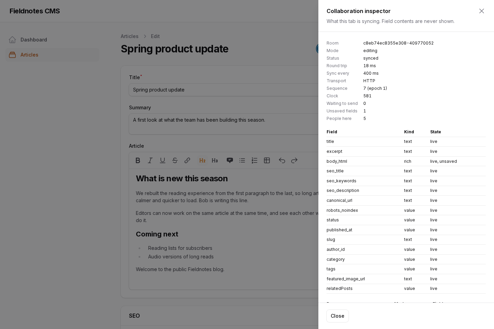
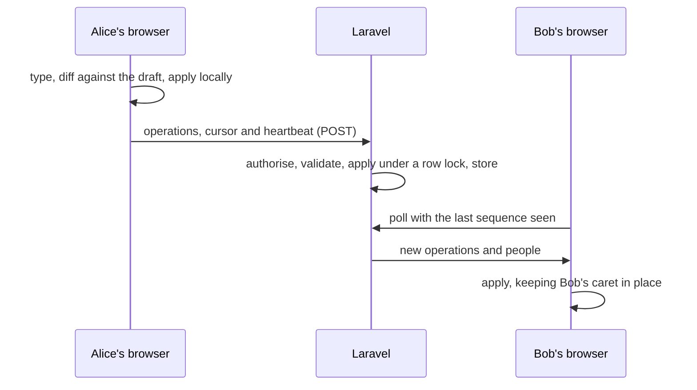
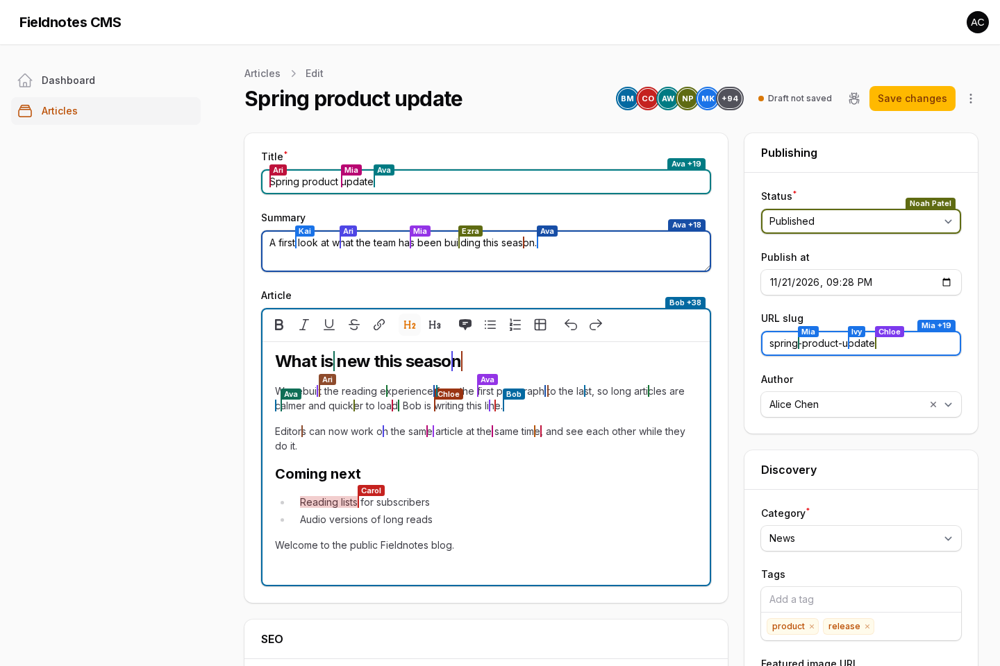
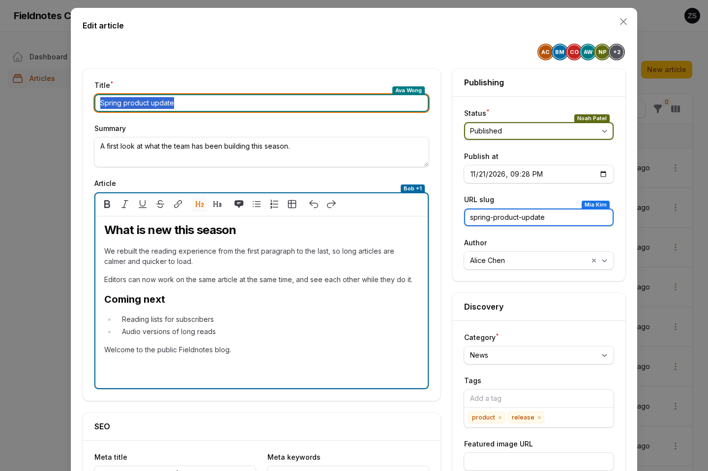
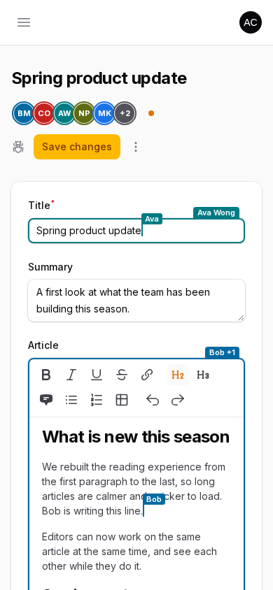

# Filament Collaboration

Google Docs-style collaborative editing for Filament: everyone on a record sees each other, edits each other's fields as they type, and saves one shared draft.


[Watch the 37-second tutorial](docs/media/tutorial.mp4): two browsers side by side.

- **Live fields.** Text inputs, textareas and Filament's own `RichEditor` merge character by character. Selects, toggles, dates and tags take the latest choice. Nothing extra is bundled into the editor.
- **See each other.** Avatars in the header, an outline and name on the field each person is in, their caret and selection, and who is on which record in tables and modals.
- **Real merging.** Two people typing in the same sentence both keep their words. Undo only undoes your own typing. Edits survive going offline and reloading.
- **No extra infrastructure.** It runs on HTTP through your Laravel app: no WebSocket server, no Node process, no Yjs. The merge engine is our own: about 1,700 lines of PHP and 850 of JavaScript implementing the same algorithm, checked against each other.
- **Merge on save for the rest.** Fields that cannot be live, and browsers that are not connected, get a field-by-field three-way merge with a conflict dialog.

## Requirements

- PHP 8.3+ (tested on 8.4), Laravel 12 or 13
- Filament 4.13.3+ or 5.8.3+
- MySQL or MariaDB, PostgreSQL or SQLite
- A cache store with atomic locks, shared by every application server (Redis, database, file on one server)

## Install

```bash
composer require solutionforest/filament-collaboration
php artisan migrate
```

Register the plugin on a panel:

```php
use SolutionForest\FilamentCollaboration\CollaborationPlugin;

$panel->plugin(CollaborationPlugin::make());
```

Then add a trait to each page:

```php
use SolutionForest\FilamentCollaboration\Concerns\HasPresence;
use SolutionForest\FilamentCollaboration\Concerns\InteractsWithCollaboration;

class EditPost extends EditRecord
{
    use InteractsWithCollaboration; // live editing, presence and merge on save
}

class ListPosts extends ListRecords
{
    use HasPresence; // also for create, view and custom pages
}
```

That is all a resource needs: its existing form fields become live.

## Tables and modals

```php
use SolutionForest\FilamentCollaboration\Tables\PresenceColumn;

$table
    ->poll('3s')
    ->columns([PresenceColumn::make()])
    ->recordActions([EditAction::make()->collaborate()]);
```


`collaborate()` gives a modal presence and merges on save. Call it last: it wraps the action's lifecycle hooks. Modal fields are not live.

## The collaboration inspector

A slide-over showing what this tab syncs: round trip, sequence, unsent changes and each field's state. It never shows field contents. Add it to any page's header actions:

```php
use SolutionForest\FilamentCollaboration\Actions\CollaborationDebugAction;

protected function getHeaderActions(): array
{
    return [CollaborationDebugAction::make(), /* ... */];
}
```

It stays hidden unless the panel enables it, for example only locally:

```php
CollaborationPlugin::make()->debug(fn (): bool => app()->isLocal())
```



## Configuration

```php
CollaborationPlugin::make()
    ->liveEditing(fn (?Model $record): bool => true) // false: presence and merge on save only
    ->pollingInterval(400)                           // milliseconds while working together
    ->avatarLimit(5)
    ->colors(['#1a73e8', /* ... */])                 // white text must be readable on each
    ->scopeRoomsUsing(fn (): mixed => auth()->user()?->team_id) // for tenancy without Filament tenancy
    ->presenceRenderHook(PanelsRenderHook::PAGE_HEADER_ACTIONS_BEFORE)
    ->fieldTypes([ValueType::make([StarRating::class])]);
```

Per field:

```php
TextInput::make('internal_notes')->collaborative(false); // merge on save only
Select::make('tags')->relationship('tags', 'name')->multiple()->collaborative(); // see below
```

Deployment settings are in `config/filament-collaboration.php`: database connection, cache store, presence timeout, token lifetime and rate limit. For PHPStan, include `vendor/solutionforest/filament-collaboration/extension.neon` so it knows about `collaborative()` and `collaborate()`.

### Your own field types

```php
use SolutionForest\FilamentCollaboration\Contracts\FieldType;
use SolutionForest\FilamentCollaboration\Enums\FieldKind;

class CodeEditorType implements FieldType
{
    public function supports(Field $field): bool
    {
        return $field instanceof CodeEditor;
    }

    public function getKind(Field $field): ?FieldKind
    {
        return FieldKind::Value; // Text, RichText, Value, or null to merge on save
    }
}
```

Presence storage is behind `Contracts\PresenceRepository`; bind your own, for example on Redis.

## What is live

| Field | Live as |
| --- | --- |
| `TextInput` (text, search, tel, url), `Textarea` | characters |
| `RichEditor` without custom blocks, mentions or plugins | characters, blocks and formatting |
| `Select`, `Toggle`, `Checkbox`, `CheckboxList`, `Radio`, `ToggleButtons`, `TagsInput`, `DateTimePicker`, `ColorPicker`, `Slider`, masked, email and number inputs | latest value |
| Many-to-many selects and checkbox lists | merge on save, unless marked `collaborative()` |
| Passwords, uploads, repeaters, builders, Markdown and code editors, hidden and disabled fields | merge on save |

Pages with a locale switcher (translatable content) merge on save, as do date pickers with a personal timezone: their state differs per person.

## How saving works

Live fields share one draft per record, kept in the database, so it survives everybody leaving. Save validates and publishes the draft's live fields as they are at that moment, including what colleagues typed, and merges the other fields with what is stored. The header shows when the draft has unsaved changes, and anyone who can edit can discard them.

A change made outside the draft, such as a modal, an import or a queued job, is merged into what people are typing. A save from a browser that was not live wins in the fields it changed.

## How it works



The draft is a CRDT, a replicated growable array (RGA): each character has an id, and is placed after the character its author saw on its left, so concurrent edits merge the same way everywhere. Rich text is one sequence in which each block is a marker carrying its path, so splitting a paragraph inserts one item and making a list never touches anyone's text. Picked values are last-writer-wins registers. The browser and PHP implementations replay the same recorded sessions in the test suite.

## Security

- Every request carries an encrypted, expiring token issued while rendering an authorised page. Each sync checks the user, panel, tenant, room scope, record and policy (`canEdit` or `canView`) again. A record that is gone or out of reach returns 404.
- Operations are validated: only fields this user can edit, only their own ids, and only allow-listed rich content. Attributes such as `onclick`, `javascript:` links or custom block HTML never reach another browser. Field names and cursors are only sent to people who can see that field.
- Rooms are scoped by tenant, `scopeRoomsUsing()` and the database name.
- Sync never writes the session, so it cannot race a save or a logout.

**Know this before enabling it:** a shared draft is shared. When you save, you publish what colleagues put in the fields you can edit, validated by your form. If some people may choose options that others may not (for example who may set "Published"), mark that field `collaborative(false)`. Revoking access to one field takes effect within the token lifetime, 15 minutes by default; revoking access to the record takes effect on the next request.

## Performance

Measured with `npm run test:load` in `demo/`: real sessions, real tokens, each editor syncing at the browser's pace and a fifth of them typing. Built-in PHP server, SQLite, 4 CPU cores.

| Editors on one article | Requests per second | Median | 95th percentile | Converged |
| --- | --- | --- | --- | --- |
| 10 | 25 | 16 ms | 19 ms | 10 / 10 |
| 25 | 39 | 14 ms | 17 ms | 25 / 25 |
| 50 | 55 | 15 ms | 18 ms | 50 / 50 |
| 100 | 77 | 16 ms | 19 ms | 100 / 100 |

A keystroke appears in another browser in 350 ms at the median and 560 ms at the 95th percentile (`npm run test:latency`). That is polling, not a socket: typing feels live, but it is not keystroke-instant. Crowded rooms and idle tabs poll less often. On a busy host, an earlier run at 100 editors measured a 1.9 s median.



## Testing

```bash
cd demo
composer install && npm install
vendor/bin/pest                # 170 tests: the package and the demo
vendor/bin/phpstan analyse     # level 10, package included
npm run test:e2e               # 32 scenarios in real browsers; BROWSER=webkit for Safari's engine
npm run test:load -- 100 45    # editors, seconds
npm run test:latency
cd .. && npm test              # the CRDT: 2,000 random sessions must converge
```

The browser scenarios cover both people typing in one input and one paragraph, IME composition, undo, tables, picked values, saving while others type, two saves at once, offline and reload, discard, carets, the list, view and create pages, modals, a phone and dark mode. Every screenshot in this README comes from `npm run media`, which signs in real sessions and refuses to save an image until what it shows is on screen.

## Demo

`demo/` is a small newsroom CMS with a public blog, 100 editors and 15 articles.

```bash
cd demo
composer install && npm install && npm run build
cp .env.example .env && php artisan key:generate
touch database/database.sqlite && php artisan migrate --seed
php artisan serve --no-reload   # several workers, as live editing needs them
```

Sign in at `/admin` as `alice@example.test` and, in another browser, `bob@example.test`. The password is `password`. The demo panel only opens in the `local` and `testing` environments, as these accounts are public.

| | |
| --- | --- |
|  |  |
|  |  |

## Limits

- Changes arrive by polling, every 0.4 s by default. There is no WebSocket transport yet.
- Repeaters, builders, uploads, Markdown and code editors, and custom rich editor blocks merge on save; they are not live.
- Links pasted with a CSS class lose the class. Images pasted as base64 make that field merge on save.
- Livewire makes text inputs read-only while their own form is saving; the rich editor stays editable.
- An image someone uploaded is only saved once they save: another person's save waits for it.
- It relies on two internals: Livewire's update queue (`queueUpdate`) and the rich editor's `getEditor()`. Both are covered by the browser tests on Filament 4.13.3, 4.17, 5.8.3 and 5.12. Laravel 12 is covered by the PHP tests only.

## License

MIT
