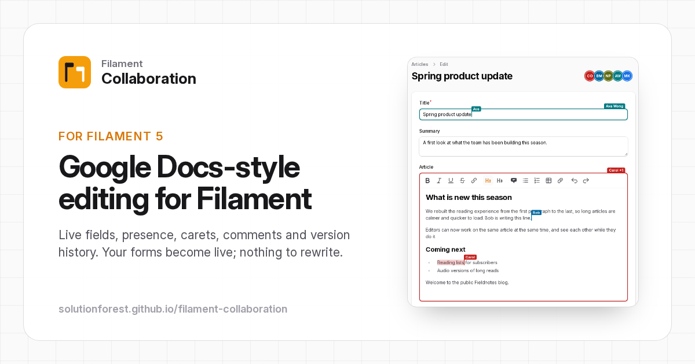
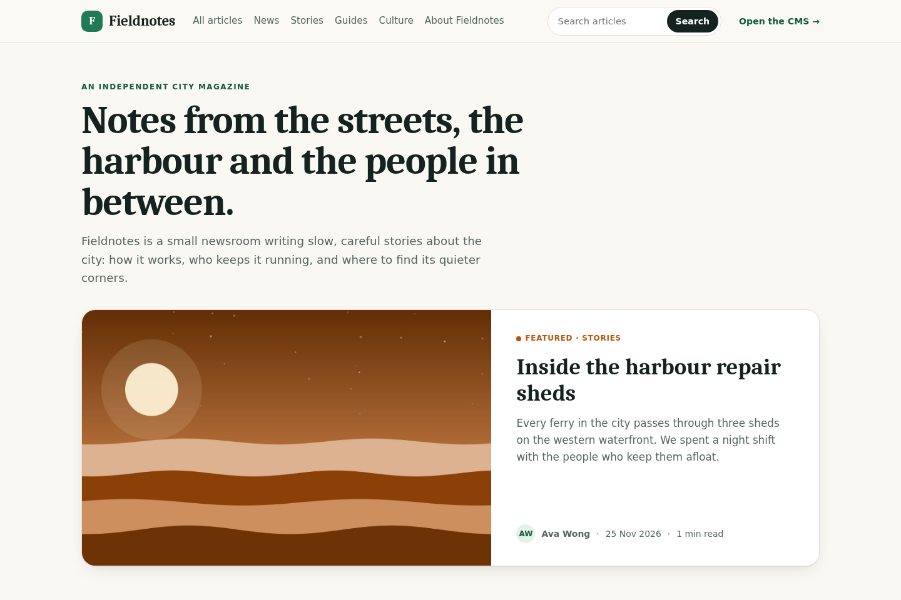
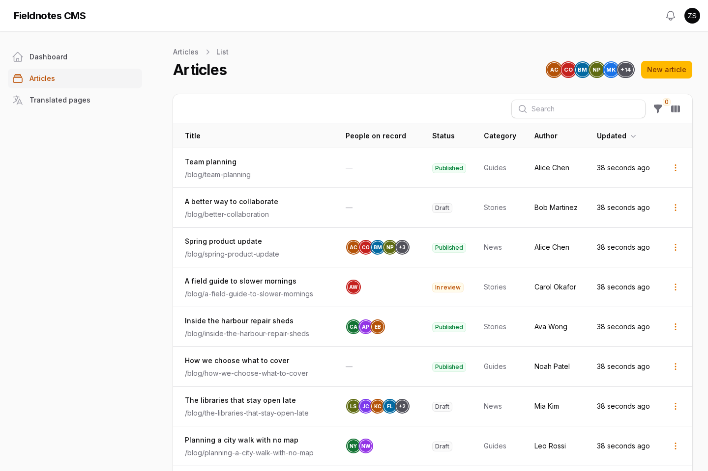
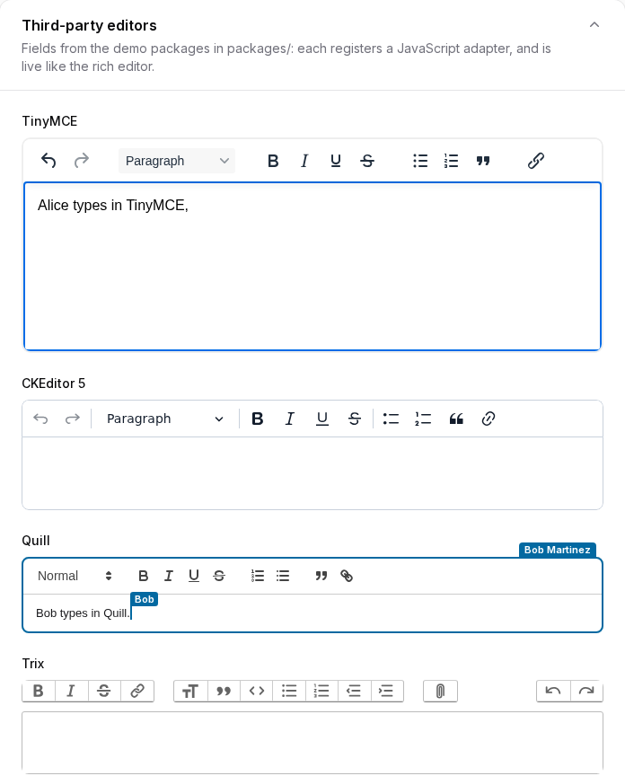
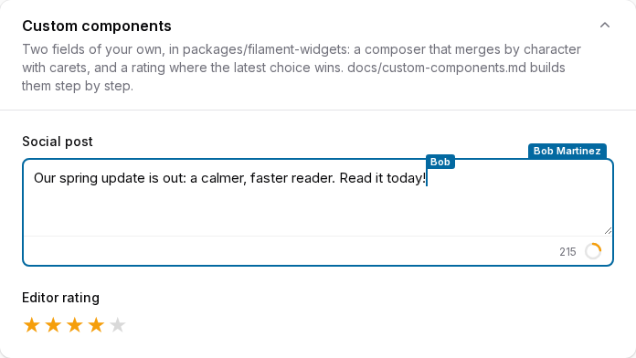

# Filament Collaboration

[](https://solutionforest.github.io/filament-collaboration/)

[](https://github.com/solutionforest/filament-collaboration/actions/workflows/tests.yml)
[](https://github.com/solutionforest/filament-collaboration/actions/workflows/chaos.yml)


**Google Docs-style collaborative editing for Filament.**

Several people can open the same record and edit it together. Each person sees who else is there, which field they are in and what they are typing. When anyone saves, everybody's changes are saved together, so nobody overwrites a colleague.

You don't rebuild your forms. Add the plugin and a trait, and the forms you already have become live.

**[Documentation](https://solutionforest.github.io/filament-collaboration/)** · **[One-minute tutorial video](docs/media/tutorial.mp4)** · **[Changelog](CHANGELOG.md)**


## Why

In a normal Filament form, the last person to press **Save** wins. If two editors open the same article, one of them silently loses their work.

Filament Collaboration fixes this in three ways:

- **Live editing.** Text merges as people type, character by character, like in Google Docs.
- **Presence.** Everyone can see who is on the record, and which field each person is in.
- **One shared draft.** Changes are kept in a draft that everybody shares, and saving saves all of it.

## Features

### Edit together

- **Live fields.** Text inputs, textareas, and Filament's `RichEditor`, Markdown and code editors merge as people type. Two people typing in the same sentence both keep their words.
- **Choices.** Selects, toggles, dates and tags take the latest choice.
- **Lists.** In repeaters and builders, adding, removing and moving items merge, and so does text inside the items.
- **Uploads.** An uploaded file appears for everyone at once. Whoever saves keeps it.
- **Undo, offline and reloads.** Undo only undoes your own typing. Edits survive losing the connection and reloading the page.
- **Everything else.** Fields that can't be live are merged field by field when you save, with a dialog if there is a real conflict.

### See each other

- **Avatars** in the page header, and **who is on which record** in your tables.
- **An outline, a name and a caret** on the field each person is in, including their text selection.
- **Hidden fields.** A colleague in a closed tab, wizard step or collapsed section shows on its header. **Follow** keeps your page on whichever field they are in.

### Comments and history

- **Comments** on the record or on one field, with `@mentions` and database notifications.
- **Version history** of the shared draft. Anyone can restore an earlier version for everybody.
- Both are in one slide-over, behind a chat icon that shows the number of open comments.

### Safe, and ready for production

- **Secure by default.** Every request is authorised again, every edit is validated, and fields a person may not see never reach their browser.
- **Permissions.** A `collaborate` policy ability decides who may edit live. Open tabs pick up permission changes.
- **Deleted records.** If someone deletes a record that others have open, they are told who deleted it, can copy their text, and can restore it if allowed.
- **Audit trail.** Optionally, keep a per-minute record of who changed which field.
- **Polling or WebSockets.** It works over plain HTTP with nothing to install. Add Laravel Reverb and a keystroke reaches others in about 60 ms instead of 350 ms.
- **Scales out.** Run several app servers on one database, with presence in Redis. A load test with 300 editors on two servers is included.

### Works with other editors and your own fields

Every field goes through the same small JavaScript **adapter** API, Filament's own fields included. The demo makes TinyMCE, CKEditor, Quill and Trix live this way, and the **[step-by-step guide](docs/custom-components.md)** shows how to do the same for your own components.

The package also ships a **[Laravel Boost](https://laravel.com/docs/boost)** skill, so AI assistants such as Claude Code, Cursor or Codex know how to use it in your app.

## Requirements

| | Supported |
| --- | --- |
| PHP | 8.3, 8.4 |
| Laravel | 12, 13 |
| Filament | 5.8.3 or later |
| Database | MySQL / MariaDB, PostgreSQL, SQLite |
| Cache | Any store with atomic locks, shared by all app servers (Redis, database; file on a single server) |
| Servers | PHP-FPM, `php artisan serve` or [Laravel Octane](docs/guide.md#laravel-octane); several panels, each with its own guard if you like ([guide](docs/guide.md#several-panels)) |
| Optional | Laravel Reverb, or any Pusher-compatible broadcaster, for pushed changes. Redis for presence across many servers. |

Every combination of PHP and Laravel is tested on each push. See [Quality](#quality).

The shared drafts, presence and sync come from [solutionforest/laravel-collaboration](https://github.com/solutionforest/laravel-collaboration), which also brings the same collaboration to Livewire and Inertia apps outside Filament. Composer installs it for you.

## Quick start

**1. Install the package**

```bash
composer require solutionforest/filament-collaboration
php artisan migrate
```

**2. Add the plugin to your panel**

```php
use SolutionForest\FilamentCollaboration\CollaborationPlugin;

public function panel(Panel $panel): Panel
{
    return $panel
        // ...
        ->plugin(CollaborationPlugin::make());
}
```

Filament publishes the package's JavaScript and CSS with its other assets. If you see no avatars, or `collaboration.js` returns a 404, run `php artisan filament:assets`.

**3. Add a trait to your resource pages**

```php
use SolutionForest\FilamentCollaboration\Concerns\HasPresence;
use SolutionForest\FilamentCollaboration\Concerns\InteractsWithCollaboration;

class EditPost extends EditRecord
{
    use InteractsWithCollaboration; // live editing, presence and merge on save
}

class ListPosts extends ListRecords
{
    use HasPresence; // shows who is here; also for create, view and custom pages
}
```

That's all. Open the same record in two browsers and start typing.

**4. Optional: comments and history**

Add the header action to an edit page:

```php
use SolutionForest\FilamentCollaboration\Actions\CollaborationPanelAction;

protected function getHeaderActions(): array
{
    return [CollaborationPanelAction::make()];
}
```

**5. Optional: real time and many servers**

- Changes arrive by polling, with nothing else to run. For instant updates, set up [Laravel Reverb](https://laravel.com/docs/reverb) and turn on `broadcasting()`. See [Real time with Reverb](docs/guide.md#5-real-time-with-reverb).
- With several app servers, keep presence in Redis with `FILAMENT_COLLABORATION_PRESENCE=redis`. See [Many servers](docs/guide.md#many-servers-and-presence-in-redis).

## Configuration

Behaviour is set on the plugin, in your panel provider. Every option is optional:

```php
CollaborationPlugin::make()
    ->liveEditing(fn (?Model $record): bool => ! $record?->is_locked) // live, or merge on save only
    ->broadcasting()                     // push changes over Reverb instead of polling
    ->commentsAndHistory(false)          // hide comments & history; or fn (Model $record): bool
    ->mentionable(fn (Model $record) => User::query()->where('team_id', $record->team_id))
    ->lockWhileEditing()                 // fields that can't be live are read-only while someone is in them
    ->audit()                            // a per-minute trail of who changed which field
    ->scopeRoomsUsing(fn () => auth()->user()?->team_id)
    ->pollingInterval(400)
    ->avatarLimit(5)
    ->debug(fn (): bool => app()->isLocal());
```

Per field:

```php
TextInput::make('internal_notes')->collaborative(false);   // not live
TextInput::make('seo_title')->collaborative('edit-seo');   // live only for people the Gate ability allows
MyEditor::make('body')->collaborative(adapter: 'my-editor', as: FieldKind::Text); // live through your adapter
```

Presence in a table, and in an edit modal:

```php
$table
    ->columns([PresenceColumn::make()])
    ->recordActions([EditAction::make()->collaborate()]);
```

Deployment settings are environment variables, read in `config/filament-collaboration.php`. For example: `FILAMENT_COLLABORATION_PRESENCE` (`database` or `redis`), `FILAMENT_COLLABORATION_CACHE_STORE`, `FILAMENT_COLLABORATION_PRESENCE_TIMEOUT` and `FILAMENT_COLLABORATION_TOKEN_LIFETIME`. Every option, with its default, is in [Configuration](docs/guide.md#6-configuration).

## Documentation

The full documentation is at **[solutionforest.github.io/filament-collaboration](https://solutionforest.github.io/filament-collaboration/)**. It is also in this repository:

- **[Usage guide](docs/guide.md)**, step by step:
  1. [Your first collaborative resource](docs/guide.md#1-your-first-collaborative-resource)
  2. [Which fields are live](docs/guide.md#2-which-fields-are-live)
  3. [Saving, drafts and conflicts](docs/guide.md#3-saving-drafts-and-conflicts)
  4. [Presence in tables and modals](docs/guide.md#4-presence-in-tables-and-modals)
  5. [Real time with Reverb](docs/guide.md#5-real-time-with-reverb)
  6. [Configuration](docs/guide.md#6-configuration)
  7. [Permissions and security](docs/guide.md#7-permissions-and-security)
  8. [Images and uploads](docs/guide.md#8-images-and-uploads)
  9. [Extending: field types, events, storage](docs/guide.md#9-extending)
  10. [Debugging](docs/guide.md#10-debugging)
  11. [Troubleshooting](docs/guide.md#11-troubleshooting)
- **[Make your own component live](docs/custom-components.md)**: build a post composer and a star rating, and their adapters, or let `php artisan make:collaborative-field` write one for you.
- **[How it works with Filament](docs/how-it-works.md)**: how the browser script works with Filament, and why not Yjs.
- **[Architecture and performance](docs/architecture.md)**: how an edit travels, and load-test results.

## Try the demo

The `demo/` folder is a complete Laravel app you can run in a few minutes: **Fieldnotes**, a small city magazine with a public blog and the Filament CMS its editors write it in. It comes with 18 articles by seven named authors, four static pages, categories, tags and 100 editors, so you can see how presence looks on a busy team. The content and the people are fictional; the covers are generated.



### Run it

```bash
cd demo
composer install && npm install && npm run build
cp .env.example .env && php artisan key:generate
touch database/database.sqlite && php artisan migrate --seed
php artisan serve --no-reload
```

The blog is at `/`. Open the CMS at `/admin` and sign in as `alice@example.test`. In a second browser, or a private window, sign in as `bob@example.test`. The password for both is `password`.

### What to try

**1. Edit an article together.** Open the same article as Alice and Bob and type in the title or the article text. Each of you sees the other's avatar, an outline and name on their field, and their caret as they type. Press **Save** in either browser, and both people's changes are saved.

**2. See who is where.** The articles list shows who is on each record. The people panel in the header lists everyone on the page.

| | |
| --- | --- |
|  |  |

**3. Leave a comment and restore a version.** Click the chat icon in the header. Comment on a field and `@mention` Bob; he gets a notification. Under **History**, restore an earlier version of the draft for everybody.

| | |
| --- | --- |
|  |  |

**4. Find a colleague out of sight.** On a translated page, when Bob is in a field behind the closed **Publishing** tab, his initials show on the tab. Click **Follow**, and your page goes wherever he goes.

| | |
| --- | --- |
|  |  |

**5. Edit two languages at once.** The blog's static pages, under **Pages**, have English and Chinese tabs. Each language has its own draft, so Alice and Bob can each work on one.

**6. Try editors from other packages.** The demo includes TinyMCE, CKEditor, Quill and Trix, each made live by a short adapter.

| | |
| --- | --- |
|  |  |

**7. Upload files and add tasks.** A file Alice uploads appears in Bob's form at once. Tasks she adds to an article's **Checklist** appear in Bob's open copy too.

| | |
| --- | --- |
|  |  |

**8. Make your own component live.** The post composer and star rating come from `demo/packages/filament-widgets`. The [guide](docs/custom-components.md) builds them step by step.



**More:**

- The **quick-edit modal** in the articles table has presence too.
- The panel works in **dark mode** and on **phones**.
- To try Redis presence, set `FILAMENT_COLLABORATION_PRESENCE=redis` in `.env`.

| | |
| --- | --- |
|  |  |

## With an AI assistant

The package ships a [Laravel Boost](https://laravel.com/docs/boost) skill, `filament-collaboration-development`, and a short guideline. In an app that uses Boost, add the package to `boost.json`:

```json
{
    "packages": ["solutionforest/filament-collaboration"]
}
```

Then update Boost:

```bash
php artisan boost:update
```

Your assistant now knows the traits, which fields are live, adapters, comments and history, relation managers, Redis presence and how to test them. You can also read the skill on its own, in [`resources/boost/skills`](resources/boost/skills/filament-collaboration-development/SKILL.md).

## Quality

Every push runs [`tests.yml`](.github/workflows/tests.yml):

| Check | What it covers |
| --- | --- |
| Pest | 332 tests on PHP 8.3 and 8.4 × Laravel 12 and 13 with Filament 5, and on the oldest supported Filament, 5.8.3. At least 95% line coverage. The whole suite runs again with presence in Redis. |
| PHPStan | Level 10, on the package and the demo |
| Pint | Laravel's code style |
| JavaScript | `tsc --strict` over JSDoc types, ESLint, and the CRDT's unit tests with at least 95% coverage |
| Browsers | 54 scenarios in Chromium, with polling and with Reverb, and in WebKit. The run fails if any browser reports an error. |
| Chaos | [Nightly](.github/workflows/chaos.yml): four browsers press random keys, and every copy must end up the same with no editor error |
| Load | [On demand](.github/workflows/load.yml): hundreds of editors across two servers, with database or Redis presence, polling or Reverb |

To run them yourself:

```bash
cd demo
vendor/bin/pest --coverage      # PHP tests
vendor/bin/phpstan analyse      # static analysis, level 10
npm run test:e2e                # real browsers; BROWSER=webkit, TRANSPORT=reverb, THROTTLE=8
SERVERS=2 PRESENCE=redis npm run test:load -- 300 45   # many editors, two servers
cd .. && npm run check          # JavaScript: lint, types and tests
```

## Limits

- Without broadcasting, changes arrive by polling, every 0.4 seconds by default.
- Inside repeater and builder items, only text inputs and textareas merge as you type, and undo there is the browser's own. Lists that hold uploads, rich text or nested lists merge when you save.
- Rich editors with custom blocks, mentions or plugins merge when you save.
- Other editors, such as TinyMCE, CKEditor, Quill or Trix, need a short [adapter](docs/guide.md#adapters-for-other-editors). The demo has working ones.
- In Safari, Filament's `CodeEditor` merges when you save rather than live, because CodeMirror 6 there can lose a keystroke when a colleague's change arrives at the same moment.
- The package relies on two Filament internals, Livewire's `queueUpdate` and the rich editor's `getEditor()`. The browser tests cover both.

More in the guide's [troubleshooting](docs/guide.md#11-troubleshooting).

## Changelog and versions

Releases follow [Semantic Versioning](https://semver.org), and every change is listed in [CHANGELOG.md](CHANGELOG.md). Until 1.0.0, a minor version may include breaking changes; they are listed under **Changed**.

## License

Filament Collaboration is open source under the MIT license. See [LICENSE](LICENSE).

The demo in `demo/` is not part of what Composer installs. Two of its example editor packages bundle GPL editors, so they are licensed GPL-2.0-or-later: `demo/packages/filament-tinymce` (TinyMCE) and `demo/packages/filament-ckeditor` (CKEditor 5). Their `LICENSE.md` files explain more. The Quill (BSD-3-Clause) and Trix (MIT) examples, and the package itself, have no such terms.
