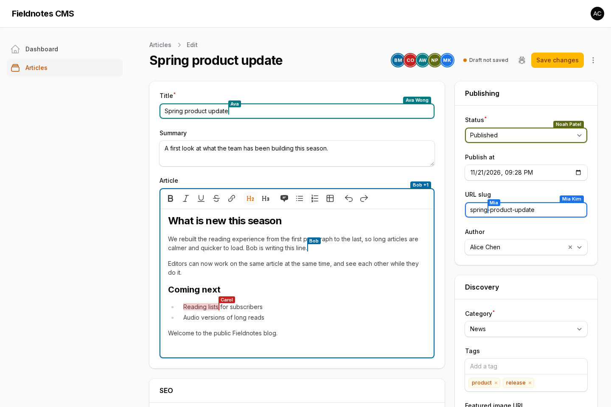
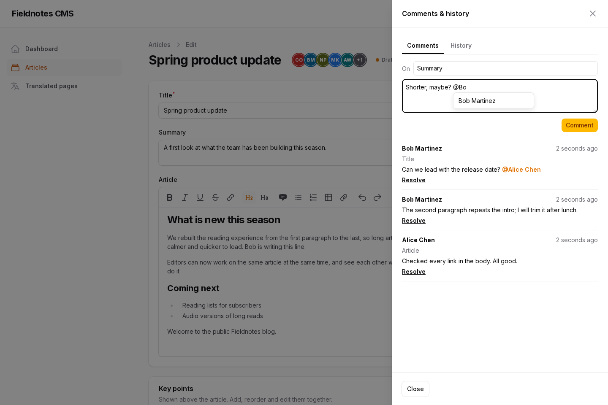
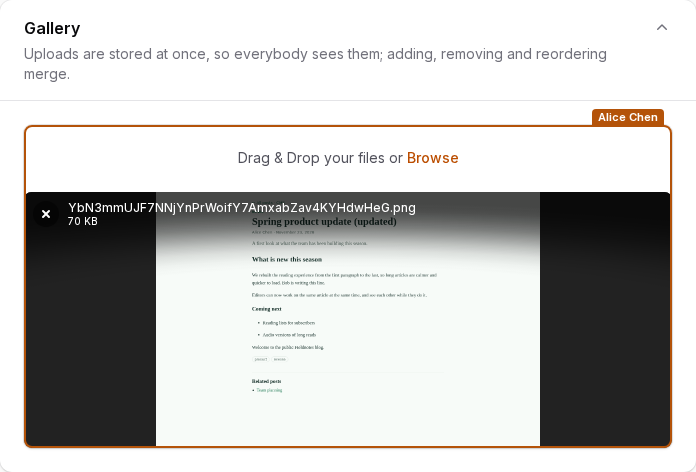

# Filament Collaboration

[](https://github.com/solutionforest/filament-collaboration/actions/workflows/tests.yml)
[](https://github.com/solutionforest/filament-collaboration/actions/workflows/chaos.yml)


**Google Docs-style collaborative editing for Filament.** Everyone on a record sees each other, edits the same fields as they type, and saves one shared draft. Your existing forms become live; there is nothing to rewrite.



▶ [Watch the one-minute tutorial](docs/media/tutorial.mp4): two browsers side by side, from typing together to comments, history and restore.

## What you get

| | |
| --- | --- |
| **Live fields** | Text inputs, textareas and Filament's own `RichEditor`, Markdown and code editors merge character by character. Selects, toggles, dates and tags take the latest choice. |
| **Lists and uploads** | Repeaters and builders: adding, removing and moving items merge, and text inside items merges by character, with carets. Uploaded files are stored at once and appear for everyone; whoever saves keeps them. |
| **One adapter API for every field** | Filament's own fields and third-party editors go through the same JavaScript adapters: formats `text`, `html`, `rich` (ProseMirror / TipTap), `value` and `items` (lists). TinyMCE, CKEditor, Quill, Trix or your own components become live the same way: **[make your own component live](docs/custom-components.md)**, step by step. |
| **Fields that cannot be live** | They show who is editing them, can lock while somebody is in them (`lockWhileEditing()`), and merge field by field on save. |
| **See each other** | Avatars in the header, an outline and name on the field each person is in, their caret and selection, and who is on which record in tables. |
| **Real merging** | Two people typing in the same sentence both keep their words. Undo only undoes your own typing. Edits survive going offline and reloading. |
| **Polling or WebSockets** | Works on plain HTTP through your Laravel app, with nothing to install. Add Laravel Reverb and a keystroke reaches others in about 60 ms instead of 350 ms. |
| **Safe by default** | Every request is authorised again, every edit is validated, and fields a person cannot see never reach their browser. |
| **Comments and history** | A chat icon in the header, with the open-comments count as its badge, opens one slide-over: comments on the record or a field with `@mentions` and database notifications, and the draft's versions, any of them restored for everybody in a click. Optional: `commentsAndHistory(false)`, or a closure per resource or record. See [Comments and version history](docs/guide.md#comments-and-version-history). |
| **Nobody out of sight** | A colleague in a field behind a closed tab, wizard step or collapsed section shows on its header; **Follow** keeps your page on whichever field they are in. |
| **Translations, uploads, relations** | Translated pages get one shared draft per language. Uploaded files appear for everyone at once. Relation managers refresh in colleagues' open copies. |
| **Scales out** | Several app servers on one database, presence in Redis, changes over Reverb; a load test with 300 editors across two servers is included. |
| **Merge on save for the rest** | Fields that cannot be live get a field-by-field three-way merge with a conflict dialog. |
| **Permissions, deletes and audit** | A `collaborate` policy ability decides who edits live; `Permissions::changed()` renews open tabs. A record deleted while open tells the others who deleted it, lets them copy their text, and restore it if the policy allows. `audit()` keeps a per-minute trail of who changed which field, and `SharedDraftSaved` names everybody who contributed. |
| **Ready for AI assistants** | Ships a [Laravel Boost](https://laravel.com/docs/boost) skill and guideline, so Claude Code, Cursor or Codex know how to use it in your app. |

## Requirements

| | Supported |
| --- | --- |
| PHP | 8.3, 8.4 |
| Laravel | 12, 13 |
| Filament | 5.8.3+ |
| Database | MySQL / MariaDB, PostgreSQL, SQLite |
| Cache | any store with atomic locks, shared by all app servers (Redis, database; file on one server) |
| Optional | Laravel Reverb (or any Pusher-compatible broadcaster) for pushed changes; Redis for presence across many servers |

Every combination of PHP and Laravel is tested on each push, see [Quality](#quality).

## Quick start

**1. Install**

```bash
composer require solutionforest/filament-collaboration
php artisan migrate
```

**2. Add the plugin to your panel**

```php
use SolutionForest\FilamentCollaboration\CollaborationPlugin;

public function panel(Panel $panel): Panel
{
    return $panel
        // ...
        ->plugin(CollaborationPlugin::make());
}
```

Filament publishes the package's JavaScript and CSS with its other assets. If the panel shows no avatars, or `collaboration.js` answers 404, run `php artisan filament:assets`.

**3. Add a trait to your resource pages**

```php
use SolutionForest\FilamentCollaboration\Concerns\HasPresence;
use SolutionForest\FilamentCollaboration\Concerns\InteractsWithCollaboration;

class EditPost extends EditRecord
{
    use InteractsWithCollaboration; // live editing, presence and merge on save
}

class ListPosts extends ListRecords
{
    use HasPresence; // who is here; also for create, view and custom pages
}
```

That's it. Open the same record in two browsers and start typing.

**4. Optional: comments and history.** Add the header action to an edit page:

```php
use SolutionForest\FilamentCollaboration\Actions\CollaborationPanelAction;

protected function getHeaderActions(): array
{
    return [CollaborationPanelAction::make()];
}
```

**Optional: real time and scale.** Changes arrive by polling with nothing else to run. For pushes, set up [Laravel Reverb](https://laravel.com/docs/reverb) and turn on `broadcasting()` ([guide](docs/guide.md#5-real-time-with-reverb)). For many app servers, keep presence in Redis with `FILAMENT_COLLABORATION_PRESENCE=redis` ([guide](docs/guide.md#many-servers-and-presence-in-redis)).

## Configuration

Behaviour is set on the plugin, in your panel provider; every option is optional:

```php
CollaborationPlugin::make()
    ->liveEditing(fn (?Model $record): bool => ! $record?->is_locked) // live, or merge on save only
    ->broadcasting()                     // push changes over Reverb instead of polling
    ->commentsAndHistory(false)          // no comments & history icon; or fn (Model $record): bool
    ->mentionable(fn (Model $record) => User::query()->where('team_id', $record->team_id))
    ->lockWhileEditing()                 // fields that cannot be live are read-only while somebody is in them
    ->audit()                            // a per-minute trail of who changed which field
    ->scopeRoomsUsing(fn () => auth()->user()?->team_id)
    ->pollingInterval(400)
    ->avatarLimit(5)
    ->debug(fn (): bool => app()->isLocal());
```

Per field: `->collaborative(false)` turns a field off, `->collaborative('edit-seo')` makes it live only for those a Gate ability allows, and `->collaborative(adapter: 'my-editor', as: FieldKind::Text)` names an adapter.

Deployment settings are environment variables, in `config/filament-collaboration.php`: `FILAMENT_COLLABORATION_PRESENCE` (`database` or `redis`), `FILAMENT_COLLABORATION_CACHE_STORE` (locks shared by all servers), `FILAMENT_COLLABORATION_PRESENCE_TIMEOUT`, `FILAMENT_COLLABORATION_TOKEN_LIFETIME` and more. Every option, with its default: [Configuration](docs/guide.md#6-configuration).

## Usage guide

The **[usage guide](docs/guide.md)** walks through everything step by step:

1. [Your first collaborative resource](docs/guide.md#1-your-first-collaborative-resource)
2. [Which fields are live](docs/guide.md#2-which-fields-are-live)
3. [Saving, drafts and conflicts](docs/guide.md#3-saving-drafts-and-conflicts)
4. [Presence in tables and modals](docs/guide.md#4-presence-in-tables-and-modals)
5. [Real time with Reverb](docs/guide.md#5-real-time-with-reverb)
6. [Configuration](docs/guide.md#6-configuration)
7. [Permissions and security](docs/guide.md#7-permissions-and-security)
8. [Images and uploads](docs/guide.md#8-images-and-uploads)
9. [Extending: field types, events, storage](docs/guide.md#9-extending)
10. [Debugging](docs/guide.md#10-debugging)
11. [Troubleshooting](docs/guide.md#11-troubleshooting)

Your own fields: **[make your own component live](docs/custom-components.md)**, a step-by-step guide with a post composer and a star rating.

How it works inside, and how fast it is: **[architecture and performance](docs/architecture.md)**.

## A taste

```php
// Only some fields live, or none on some records
TextInput::make('internal_notes')->collaborative(false);
CollaborationPlugin::make()->liveEditing(fn (?Model $record): bool => ! $record?->is_locked);

// Presence in a table, and in an edit modal
$table->columns([PresenceColumn::make()])->recordActions([EditAction::make()->collaborate()]);

// Changes pushed over Reverb instead of polled
CollaborationPlugin::make()->broadcasting();
```


## Try the demo

`demo/` is a small newsroom CMS with a public blog, 100 editors and 15 articles.

```bash
cd demo
composer install && npm install && npm run build
cp .env.example .env && php artisan key:generate
touch database/database.sqlite && php artisan migrate --seed
php artisan serve --no-reload
```

Sign in at `/admin` as `alice@example.test` and, in another browser, `bob@example.test` (password `password`).

| | |
| --- | --- |
|  |  |
|  |  |

**Comments and history**, in one slide-over behind the chat icon: comments on a field with `@mentions`, and versions of the shared draft to restore.

| | |
| --- | --- |
|  |  |

**Out of sight, but not out of mind**: Bob is in a field behind the closed Publishing tab, so his initials are on the tab. Following him opens it.

| | |
| --- | --- |
|  |  |

**Two languages at once**, each in its own draft, and **editors from other packages**, live through an adapter:

| | |
| --- | --- |
|  |  |

**Uploads and relation managers**: a file Alice uploads is in Bob's form at once, and so are the tasks she adds to the checklist.

| | |
| --- | --- |
|  |  |

**Your own components**: a post composer and a star rating from `demo/packages/filament-widgets`, live through adapters. [The guide](docs/custom-components.md) builds them step by step.


The demo also has a **Translated pages** resource (English and Chinese, in tabs) and a **Checklist** relation manager on articles. To run it on Redis presence, set `FILAMENT_COLLABORATION_PRESENCE=redis` in `.env`.

## With an AI assistant

The package ships a [Laravel Boost](https://laravel.com/docs/boost) skill, `filament-collaboration-development`, and a short guideline. In an app that uses Boost, add the package to `boost.json` and update:

```json
{
    "packages": ["solutionforest/filament-collaboration"]
}
```

```bash
php artisan boost:update
```

Your assistant then knows the traits, which fields are live, adapters, comments and history, relation managers, Redis presence and how to test them. The skill is in [`resources/boost/skills`](resources/boost/skills/filament-collaboration-development/SKILL.md), readable on its own too.

## Quality

Each push runs [`tests.yml`](.github/workflows/tests.yml):

| Check | What |
| --- | --- |
| Pest | 332 tests on PHP 8.3 and 8.4 × Laravel 12 and 13 with Filament 5, plus the oldest supported Filament, 5.8.3; at least 95% line coverage; the whole suite again with presence in Redis |
| PHPStan | level 10, on the package and the demo |
| Pint | Laravel's code style |
| JavaScript | `tsc --strict` over JSDoc types, ESLint, and the CRDT's unit tests with at least 95% coverage |
| Browsers | 54 scenarios, plus a check that no browser reported an error, in Chromium with polling and with Reverb, and in WebKit |
| Chaos | [nightly](.github/workflows/chaos.yml): four browsers pressing random keys must converge with no editor error |
| Load | [on demand](.github/workflows/load.yml): hundreds of editors across two servers, database or Redis presence, polling or Reverb |

Run them yourself:

```bash
cd demo
vendor/bin/pest --coverage      # PHP tests
vendor/bin/phpstan analyse      # static analysis, level 10
npm run test:e2e                # real browsers; BROWSER=webkit, TRANSPORT=reverb, THROTTLE=8
SERVERS=2 PRESENCE=redis npm run test:load -- 300 45   # many editors, two servers
cd .. && npm run check          # JavaScript: lint, types and tests
```

## Limits

- Without broadcasting, changes arrive by polling, every 0.4 s by default.
- Inside repeater and builder items, only text inputs and textareas merge by character, and undo there is the browser's own. Lists holding uploads, rich text or nested lists merge on save.
- Rich editors with custom blocks, mentions or plugins merge on save. Other editors (TinyMCE, CKEditor, Quill, Trix...) are live through a short [adapter](docs/guide.md#adapters-for-other-editors); the demo has working ones.
- In Safari (WebKit), Filament's `CodeEditor` merges on save rather than live: CodeMirror 6 there can lose a keystroke when a colleague's change lands mid-keystroke.
- It relies on two Filament internals, Livewire's `queueUpdate` and the rich editor's `getEditor()`, both covered by the browser tests.

More in the guide's [troubleshooting](docs/guide.md#11-troubleshooting).

## License

MIT: see [LICENSE](LICENSE).

The demo in `demo/` is not part of what Composer installs. Two of its example editor packages bundle GPL editors, so they are GPL-2.0-or-later: `demo/packages/filament-tinymce` (TinyMCE) and `demo/packages/filament-ckeditor` (CKEditor 5). Their `LICENSE.md` files say more. The Quill (BSD-3-Clause) and Trix (MIT) examples, and the package itself, carry no such terms.
