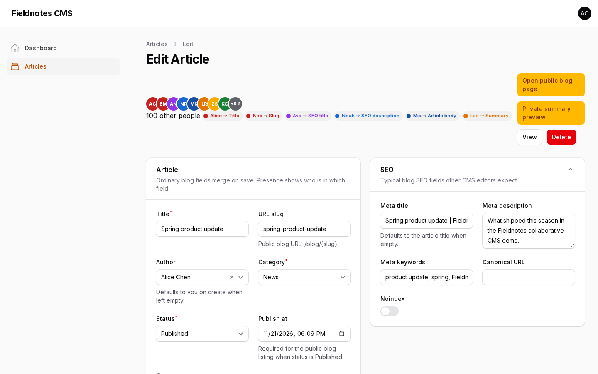

# Filament collaboration

Installable Filament collaboration package plus a Fieldnotes CMS demo. Built to match the plugin’s collaboration surface without depending on `third-party/collaboration-plugin`, then go further with a shared Yjs draft.

## Package

Path package: `packages/filament-collaboration` (`solutionforest/filament-collaboration`).

```php
use SolutionForest\FilamentCollaboration\Concerns\InteractsWithCollaboration;
use SolutionForest\FilamentCollaboration\Concerns\HasPresence;
use SolutionForest\FilamentCollaboration\Actions\CollaborateAction;
use SolutionForest\FilamentCollaboration\Tables\PresenceColumn;

class EditPost extends EditRecord
{
    use InteractsWithCollaboration;
}

class ViewPost extends ViewRecord
{
    use HasPresence;
}

// Table
PresenceColumn::make('presence');
CollaborateAction::configure(EditAction::make()); // or EditAction::make()->collaborate()
```

feature parity in this package:

- Record presence (Livewire heartbeat + cache store) and field focus
- Field-by-field three-way merge on save, conflict dialog, pull-their-changes notice
- Modal edit merge (`collaborate()` / `CollaborateAction::configure`)
- Table presence column
- Events: `ChangesMerged`, `ConflictDetected`, `ConflictResolved`
- Tenant/workspace rooms via `PresenceStore::resolveRoomUsing()`

Beyond the plugin: the demo still ships a Yjs/Tiptap **shared draft** over HTTP polling (independent of form save).

See `packages/filament-collaboration/README.md`.

## Demo (Fieldnotes CMS)



[Article list](docs/media/cms-articles.png) · [Conflict dialog](docs/media/conflict-dialog.png) · [Private summary preview](docs/media/cms-preview.png)

### Run locally

```sh
composer install
cp .env.example .env
php artisan key:generate
mkdir -p database
touch database/database.sqlite
php artisan migrate --seed
php artisan filament:assets
npm ci
npm run build
php artisan serve
```

Open `http://127.0.0.1:8000/admin` in two browser profiles as `alice@example.test` / `bob@example.test` (password `password`). Local disposable accounts only.

### Checks

```sh
./vendor/bin/pest
./vendor/bin/phpstan analyse --no-progress
./vendor/bin/pint --test
npm run build
```

## Limitations

- Shared draft Yjs updates are still opaque bytes (no server-side Yjs validation).
- Publish workflow, reliable offline, multi-database concurrency validation and security review remain open.
- the plugin extras not fully mirrored yet: spatie-translatable locale merge, leave beacon middleware matrix, and their full comparison edge-case suite.
- Demo presence HTTP endpoint and package Livewire presence both run; unify further before a public release.
- Keep the PR draft; use only local fake data.
