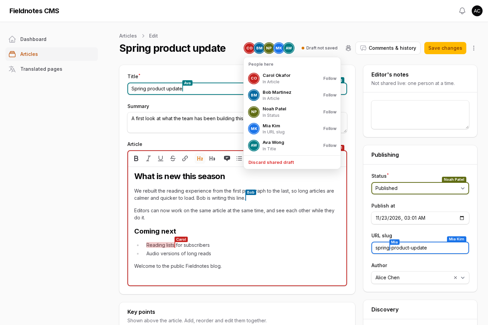
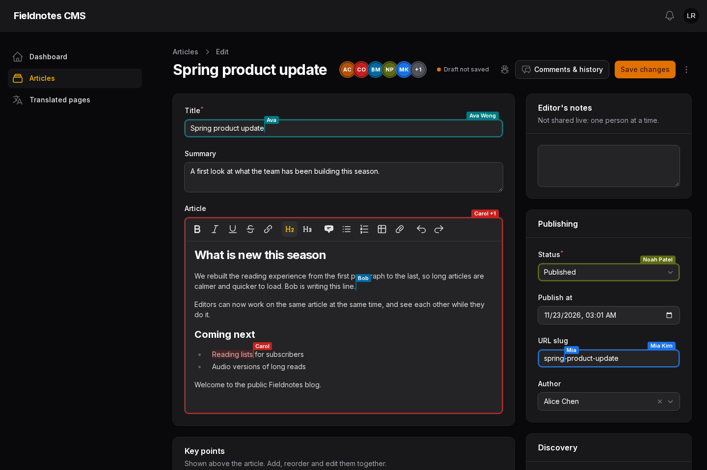

# Filament Collaboration

[](https://github.com/solutionforest/filament-collaboration/actions/workflows/tests.yml)
[](https://github.com/solutionforest/filament-collaboration/actions/workflows/chaos.yml)


**Google Docs-style collaborative editing for Filament.** Everyone on a record sees each other, edits the same fields as they type, and saves one shared draft. Your existing forms become live; there is nothing to rewrite.


▶ [Watch the 37-second tutorial](docs/media/tutorial.mp4): two browsers side by side.

## What you get

| | |
| --- | --- |
| **Live fields** | Text inputs, textareas and Filament's own `RichEditor`, Markdown and code editors merge character by character, also inside repeaters and builders. Selects, toggles, dates and tags take the latest choice. |
| **Any editor** | TinyMCE, CKEditor, Quill, Trix or your own become live through a short JavaScript [adapter](docs/guide.md#adapters-for-other-editors); fields that cannot be live say who is editing them, and can lock. |
| **See each other** | Avatars in the header, an outline and name on the field each person is in, their caret and selection, and who is on which record in tables. |
| **Real merging** | Two people typing in the same sentence both keep their words. Undo only undoes your own typing. Edits survive going offline and reloading. |
| **Polling or WebSockets** | Works on plain HTTP through your Laravel app, with nothing to install. Add Laravel Reverb and a keystroke reaches others in about 60 ms instead of 350 ms. |
| **Safe by default** | Every request is authorised again, every edit is validated, and fields a person cannot see never reach their browser. |
| **Merge on save for the rest** | Fields that cannot be live get a field-by-field three-way merge with a conflict dialog. |

## Requirements

| | Supported |
| --- | --- |
| PHP | 8.3, 8.4 |
| Laravel | 12, 13 |
| Filament | 5.8.3+ |
| Database | MySQL / MariaDB, PostgreSQL, SQLite |
| Cache | any store with atomic locks, shared by all app servers (Redis, database; file on one server) |

Every combination of PHP and Laravel is tested on each push, see [Quality](#quality).

## Quick start

**1. Install**

```bash
composer require solutionforest/filament-collaboration
php artisan migrate
```

**2. Add the plugin to your panel**

```php
use SolutionForest\FilamentCollaboration\CollaborationPlugin;

public function panel(Panel $panel): Panel
{
    return $panel
        // ...
        ->plugin(CollaborationPlugin::make());
}
```

**3. Add a trait to your resource pages**

```php
use SolutionForest\FilamentCollaboration\Concerns\HasPresence;
use SolutionForest\FilamentCollaboration\Concerns\InteractsWithCollaboration;

class EditPost extends EditRecord
{
    use InteractsWithCollaboration; // live editing, presence and merge on save
}

class ListPosts extends ListRecords
{
    use HasPresence; // who is here; also for create, view and custom pages
}
```

That's it. Open the same record in two browsers and start typing.

## Usage guide

The **[usage guide](docs/guide.md)** walks through everything step by step:

1. [Your first collaborative resource](docs/guide.md#1-your-first-collaborative-resource)
2. [Which fields are live](docs/guide.md#2-which-fields-are-live)
3. [Saving, drafts and conflicts](docs/guide.md#3-saving-drafts-and-conflicts)
4. [Presence in tables and modals](docs/guide.md#4-presence-in-tables-and-modals)
5. [Real time with Reverb](docs/guide.md#5-real-time-with-reverb)
6. [Configuration](docs/guide.md#6-configuration)
7. [Permissions and security](docs/guide.md#7-permissions-and-security)
8. [Images and uploads](docs/guide.md#8-images-and-uploads)
9. [Extending: field types, events, storage](docs/guide.md#9-extending)
10. [Debugging](docs/guide.md#10-debugging)
11. [Troubleshooting](docs/guide.md#11-troubleshooting)

How it works inside, and how fast it is: **[architecture and performance](docs/architecture.md)**.

## A taste

```php
// Only some fields live, or none on some records
TextInput::make('internal_notes')->collaborative(false);
CollaborationPlugin::make()->liveEditing(fn (?Model $record): bool => ! $record?->is_locked);

// Presence in a table, and in an edit modal
$table->columns([PresenceColumn::make()])->recordActions([EditAction::make()->collaborate()]);

// Changes pushed over Reverb instead of polled
CollaborationPlugin::make()->broadcasting();
```


## Try the demo

`demo/` is a small newsroom CMS with a public blog, 100 editors and 15 articles.

```bash
cd demo
composer install && npm install && npm run build
cp .env.example .env && php artisan key:generate
touch database/database.sqlite && php artisan migrate --seed
php artisan serve --no-reload
```

Sign in at `/admin` as `alice@example.test` and, in another browser, `bob@example.test` (password `password`).

| | |
| --- | --- |
|  |  |
|  |  |

## Quality

Each push runs [`tests.yml`](.github/workflows/tests.yml):

| Check | What |
| --- | --- |
| Pest | 281 tests on PHP 8.3 and 8.4 × Laravel 12 and 13 with Filament 5, plus the oldest supported Filament, 5.8.3; at least 95% line coverage |
| PHPStan | level 10, on the package and the demo |
| Pint | Laravel's code style |
| JavaScript | `tsc --strict` over JSDoc types, ESLint, and the CRDT's unit tests with at least 95% coverage |
| Browsers | 47 scenarios in Chromium with polling and with Reverb, and in WebKit |
| Chaos | [nightly](.github/workflows/chaos.yml): four browsers pressing random keys must converge with no editor error |

Run them yourself:

```bash
cd demo
vendor/bin/pest --coverage      # PHP tests
vendor/bin/phpstan analyse      # static analysis, level 10
npm run test:e2e                # real browsers; BROWSER=webkit, TRANSPORT=reverb
cd .. && npm run check          # JavaScript: lint, types and tests
```

## Limits

- Without broadcasting, changes arrive by polling, every 0.4 s by default.
- Inside repeater and builder items, only text inputs and textareas merge by character, and undo there is the browser's own. Lists holding uploads, rich text or nested lists merge on save.
- Rich editors with custom blocks, mentions or plugins merge on save. Other editors (TinyMCE, CKEditor, Quill, Trix...) are live through a short [adapter](docs/guide.md#adapters-for-other-editors); the demo has working ones.
- In Safari (WebKit), Filament's `CodeEditor` merges on save rather than live: CodeMirror 6 there can lose a keystroke when a colleague's change lands mid-keystroke.
- It relies on two Filament internals, Livewire's `queueUpdate` and the rich editor's `getEditor()`, both covered by the browser tests.

More in the guide's [troubleshooting](docs/guide.md#11-troubleshooting).

## License

MIT
