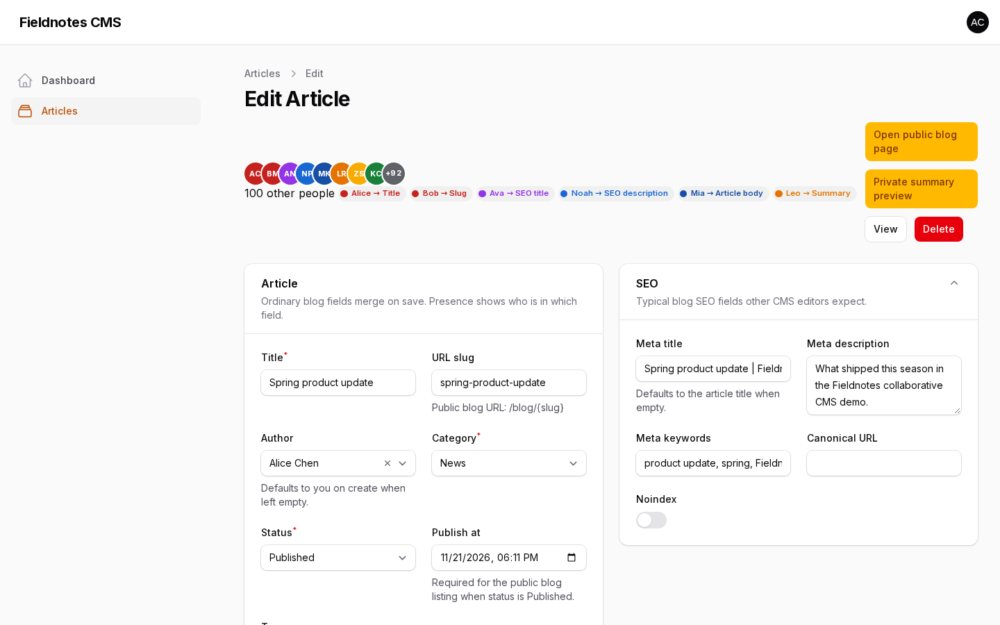
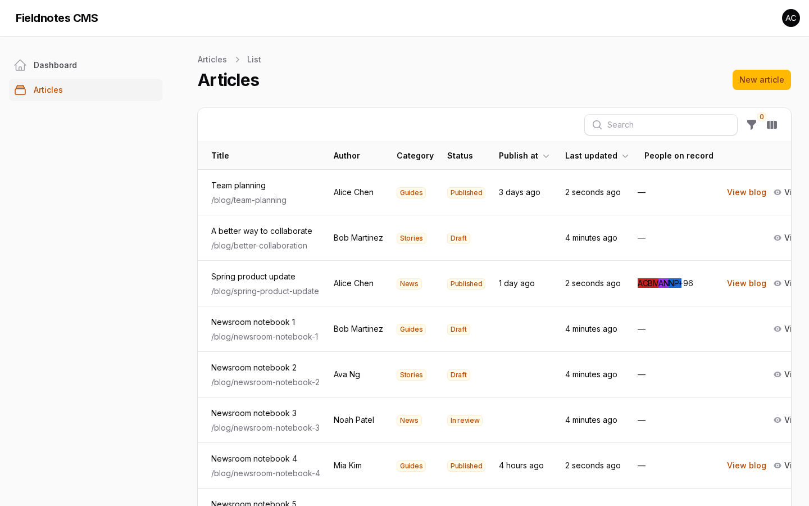
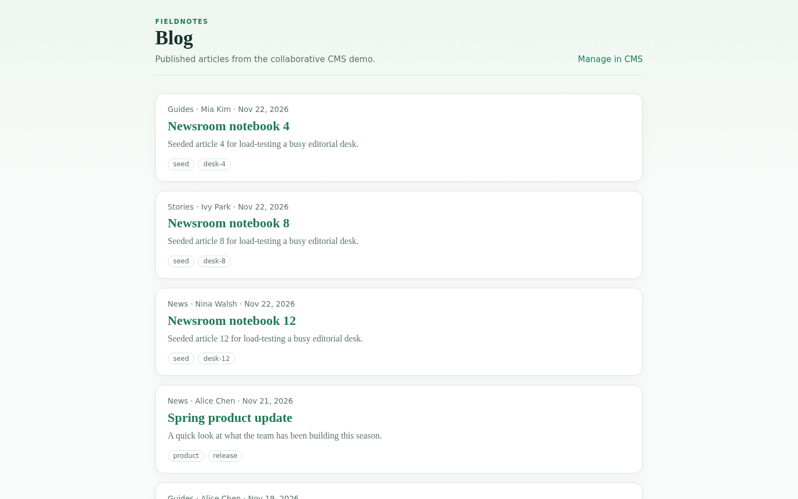

# Filament Collaboration

Installable Filament package for collaborative editing: live presence, field-level three-way merge on save, conflict UI, modal edits, and an optional TipTap + Yjs rich editor.

**This repository is the package.** The runnable Fieldnotes CMS lives in [`demo/`](demo/).

```
/
├── src/                 # package PHP
├── resources/           # views, lang, Alpine dist
├── config/
├── demo/                # Laravel + Filament blog CMS demo
└── docs/media/          # screenshots
```

## Requirements

- PHP 8.3+
- Laravel 12 or 13
- Filament 4.13.3+ or 5.8.3+
- Shared cache with atomic locks (Redis / database) in production

## Install

```bash
composer require solutionforest/filament-collaboration
php artisan vendor:publish --tag=filament-collaboration-config
```

## Quick API

| Piece | Purpose |
| --- | --- |
| `InteractsWithCollaboration` | Edit pages: merge-on-save, conflicts, presence, pull-their-changes |
| `HasPresence` | View pages: header avatar stack + field focus |
| `PresenceColumn` | Table column: who is on each record (avatar stack + `+N`) |
| `EditAction::collaborate()` / `CollaborateAction` | Modal edit with merge + optional presence |
| `CollaborativeRichEditor` | Optional live rich text (TipTap + Yjs over HTTP) |
| `Collaboration::store()` | Presence / last-save cache API |
| `PresenceStore::room()` / `resolveRoomUsing()` | Room keys (multi-tenant safe) |
| Events | `ChangesMerged`, `ConflictDetected`, `ConflictResolved` |

### Edit page

```php
use SolutionForest\FilamentCollaboration\Concerns\InteractsWithCollaboration;

class EditPost extends EditRecord
{
    use InteractsWithCollaboration;

    protected function getCollaborationIgnoredFields(): array
    {
        return ['live_draft']; // CRDT pad is authoritative
    }
}
```

### Table

```php
use SolutionForest\FilamentCollaboration\Tables\PresenceColumn;

$table->poll('10s')->columns([
    PresenceColumn::make('presence'),
]);
```

### Live rich editor (optional)

```php
use SolutionForest\FilamentCollaboration\Forms\Components\CollaborativeRichEditor;

CollaborativeRichEditor::make('live_draft');
```

Yjs is **not** required for presence, merge, conflicts, or ordinary fields. Use it only when two people type the same rich text at once.

Full usage notes: keep reading below / see `demo/` for a complete CMS.

## Demo app

```bash
cd demo
composer install
cp .env.example .env   # if needed
php artisan key:generate
touch database/database.sqlite
php artisan migrate --seed
npm install
npm run build          # demo assets + package Alpine build
php artisan serve
```

- CMS: `http://127.0.0.1:8000/admin` — `alice@example.test` / `password`
- Public blog: `http://127.0.0.1:8000/blog`
- Seed: 100 editors + 15 articles; Spring product update has busy presence for screenshots

### Screenshots








## What is “presence” vs the old demo panel?

Package UX (what you should use):

- **Header avatars** — Google-style stack of who is on this record
- **Field outlines + name tags** — which editor is in which field
- **People on record** — `PresenceColumn` on the list (same PresenceStore)

The previous demo-only “Collaboration” HTML panel (Vite `collaboration.js`) was removed. It duplicated package presence over a separate HTTP table and made the list column look empty. Presence now flows through `Collaboration::store()` only.

## License

MIT
