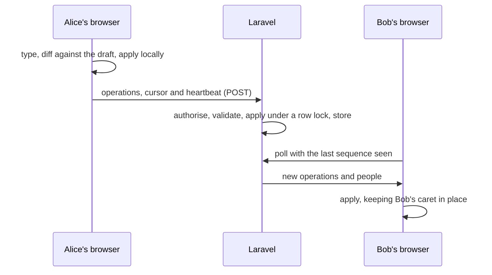
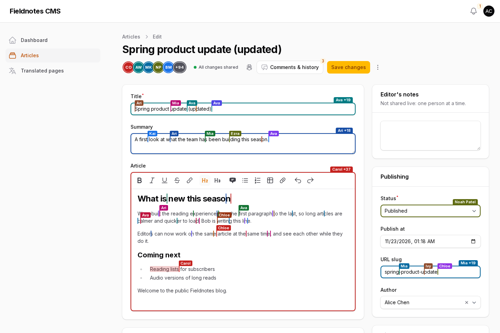

# Architecture and performance

You do not need this page to use the package. It explains what happens underneath, for reviewers and contributors.

## The flow of an edit

With broadcasting on, the server also pushes the new operations to everyone in the room as soon as it stores them, and Bob's browser applies them without asking.

## In the browser

Every field is bound through an **adapter**, Filament's own exactly like a third party's: `filament-text-input`, `filament-value`, `filament-rich-editor`, `filament-repeater`, `filament-file-upload`, `filament-markdown-editor` and `filament-code-editor` are registered with the same `FilamentCollaboration.adapter()` an app uses, in `resources/js/adapters/filament.js`. One binding, `bindings/adapter.js`, connects any adapter to the shared draft: what is typed goes to the draft, what colleagues type is written back with the caret kept, per-person undo, carets to draw and recovery from editor errors. Lists use the same binding with the `items` format: items by key, their text sub-fields merged by character.

## The shared draft

The draft is a CRDT, so edits made at the same time merge the same way in every browser and on the server:

- **Text** is a replicated growable array (RGA). Each character has an id, `[clock, client]`, and is placed after the character its author saw on its left.
- **Rich text** is one such sequence. Each block is a marker carrying its path in the document tree, so splitting a paragraph inserts one item and making a list never touches anyone's text. Marks are formatting on the characters.
- **Picked values** are last-writer-wins registers.
- **Repeaters and builders** are a sequence of item keys, so adding, removing and moving items merge like text. Text sub-fields are sequences of their own; other sub-fields are registers.

Laravel Collaboration owns the PHP engine in `src/Crdt` and the JavaScript engine in `resources/js/crdt`. The Filament browser build imports the core's `@solutionforest/laravel-collaboration/crdt/*` exports and bundles them with its field adapters. Both implementations replay the same recorded sessions (`tests/Fixtures/convergence.json` in the plugin repo), and the JavaScript tests run 2,000 random sessions with four editors that must all converge. [Laravel Collaboration source](https://github.com/solutionforest/laravel-collaboration)

## The server

Filament registers the panel route, checks access through its resource and panel policies, and saves through Filament. The core processes sync requests and manages drafts, presence, comments and history using the plugin's configuration and table prefix.

- `POST {panel}/_collaboration/sync` carries a page's edits, caret and heartbeat in one request, and answers with what the page is missing.
- Each page renders an encrypted token naming its room, user, panel, tenant, record and the fields it may read and write. Each request is authorised again against it.
- Drafts are stored in `filament_collaboration_documents`, with an update log in `filament_collaboration_updates`. Writes happen under a row lock. The log is compacted once a draft is clean and nobody is editing.
- Sync never writes the session, so it cannot race a save or a logout.
- Save takes a cache lock per record, publishes the live fields from the draft, and three-way merges the rest.
- With a Redis or Memcached cache store, each draft's head (epoch, sequence, version, unsaved fields) is cached under a random token that every committed change renews, so a poll with nothing new reads no draft from the database.
- Presence is one record per open tab, in `filament_collaboration_participants` by default. With `FILAMENT_COLLABORATION_PRESENCE=redis` it is in Redis instead: per room a hash of tabs and a sorted set of when each was last seen, per resource a sorted set of its tabs. An unchanged heartbeat is written only every few seconds either way.
- Several application servers can share one database and one cache store: a request may reach any of them.
- Comments, versions of the draft, uploads stored for it and the per-minute edit trail have tables of their own (`filament_collaboration_comments`, `_versions`, `_uploads`, `_edits`). A relation manager's changes raise a counter per room in the cache, pushed or polled like everything else.

## Performance

Measured with `npm run test:load` in `demo/`: real sessions, real tokens, each editor syncing at the browser's pace and a fifth of them typing. Built-in PHP server, SQLite, 4 CPU cores.

| Editors on one article | Requests per second | Median | 95th percentile | Converged |
| --- | --- | --- | --- | --- |
| 10 | 25 | 16 ms | 19 ms | 10 / 10 |
| 25 | 39 | 14 ms | 17 ms | 25 / 25 |
| 50 | 55 | 15 ms | 18 ms | 50 / 50 |
| 100 | 77 | 16 ms | 19 ms | 100 / 100 |

With polling, a keystroke appears in another browser in 350 ms at the median and 560 ms at the 95th percentile (`npm run test:latency`). Crowded rooms and idle tabs poll less often.

### Polling against Reverb

The same load test with `TRANSPORT=reverb`. Every simulated editor listens on a real Reverb socket and applies pushes as the browser does. "Typed to seen" is from one editor's edit to every other editor having it.

| Room | Transport | Requests per second | Typed to seen, median | 95th percentile |
| --- | --- | --- | --- | --- |
| 10 editors, all active | polling | 25 | 359 ms | 522 ms |
| | Reverb | 26 | 61 ms | 70 ms |
| 100 editors, 10 active | polling | 78 | 996 ms | 1,686 ms |
| | Reverb | 21 | 54 ms | 55 ms |
| 100 editors, all moving carets, 20 typing | polling | 81 | 1,083 ms | 1,645 ms |
| | Reverb | 101 | 65 ms | 78 ms |

Pushes make changes 6 to 20 times faster. A room where most people read gets far fewer requests, since nobody needs to poll. The worst case, everyone moving a caret at once, costs more: the server posts every change to Reverb, which raised its own 95th percentile to 780 ms on this machine, while edits still arrived in 65 ms.

### Two servers, and presence in Redis

`SERVERS=2` runs two application servers on one database and spreads the editors over them; `PRESENCE=redis` keeps presence in Redis. Besides convergence, the test checks that every editor counts every other one, whichever server they are on. 300 editors for 40 seconds, polling, on a **single-CPU** machine where both servers, SQLite and the crowd share the core:

| Setup | Requests per second | Request 95th percentile | Typed to seen, median | Everybody sees everybody | Converged |
| --- | --- | --- | --- | --- | --- |
| 1 server, database presence | 73 | 4.9 s | 8.5 s | 300 / 300 | 300 / 300 |
| 2 servers, database presence | 75 | 4.9 s | 8.7 s | 300 / 300 | 300 / 300 |
| 2 servers, Redis presence | 76 | 4.1 s | 6.9 s | 300 / 300 | 300 / 300 |

On one core this measures correctness across servers, not how throughput scales: the latencies are the CPU queue. Redis presence still cut the slowest requests by a sixth. The **Load** workflow runs the same matrix, with Reverb too, on a CI runner and reports its core count.

## Tests

| Command | Where | What |
| --- | --- | --- |
| `vendor/bin/pest` | `demo/` | Package unit tests and demo feature tests. Set `FILAMENT_COLLABORATION_PRESENCE=redis` to run them on Redis presence. |
| `vendor/bin/phpstan analyse` | `demo/` | level 10, on the package and the demo |
| `npm run test:e2e` | `demo/` | Real-browser scenarios. Set `BROWSER=webkit` for WebKit, `TRANSPORT=reverb` for Reverb or `THROTTLE=8` for a slow CPU. |
| `npm run test:chaos -- 10 42` | `demo/` | four browsers pressing random keys; every round must converge |
| `npm run test:load -- 100 45` | `demo/` | editors and seconds; `TRANSPORT=reverb`, `ACTIVE=0.1`, `SERVERS=2`, `PRESENCE=redis` and `CACHE=redis` (cache and sessions in Redis) also apply |
| `npm run test:latency` | `demo/` | key press to another screen |
| `npm run check` | root | ESLint, `tsc --strict` over the JSDoc types, and the CRDT tests |
| `npm run media` / `npm run tutorial` | `demo/` | the README's screenshots and video, from real sessions |

The browser JavaScript is plain ES modules with JSDoc types. `npm run typecheck` checks it with TypeScript in strict mode, so a wrong type fails the build the way PHPStan does for PHP. `resources/js/types.d.ts` holds the shared types.
