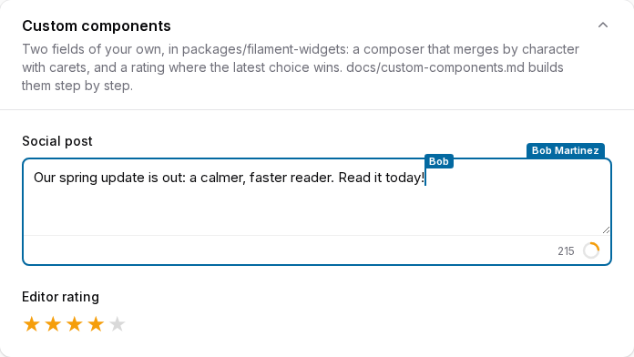
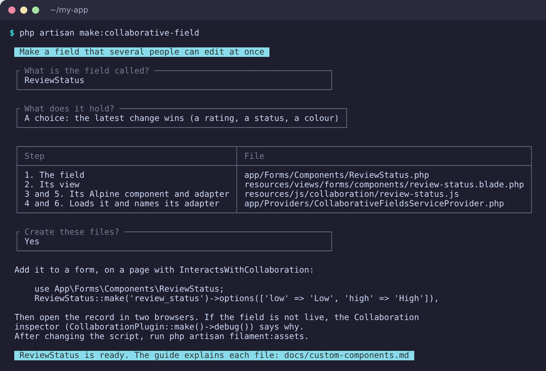
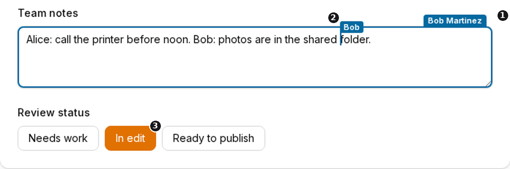

# Make your own component live

Filament Collaboration knows Filament's own fields, and makes them live through the very adapter API this guide uses: a text input is the `filament-text-input` adapter, the rich editor `filament-rich-editor`, pickers `filament-value`, in `resources/js/adapters/filament.js`. A field of your own, or one from another package, is not live at first: it merges on save, and the others see who is in it. This guide makes such a field live in about 60 lines of JavaScript, with two working examples from the demo:

- **Post composer**: a textarea inside an Alpine component, with a character counter. Two people typing in it at once both keep their words, and each sees where the other's caret is.
- **Star rating**: a row of buttons. The latest click wins, as with Filament's own `Select` and `Toggle`.



The code is in [`demo/packages/filament-widgets`](../demo/packages/filament-widgets). To see it run, open an article in the demo in two browsers and scroll to **Custom components**.

## The quick way: let a command write it

The steps below are what `make:collaborative-field` writes for you. It asks for the field's name and what it holds, then makes the field, its view, its Alpine component with its adapter, and a service provider that loads the script and names the adapter:

```bash
php artisan make:collaborative-field
```



Then use it in a form on a page with `InteractsWithCollaboration`:

```php
use App\Forms\Components\ReviewStatus;

ReviewStatus::make('review_status')->options(['draft' => 'Needs work', 'edit' => 'In edit', 'ready' => 'Ready to publish']);
```

Open the record in two browsers, and both fields are live. This is Alice's screen while Bob types in a text field made with `--kind=text`; each person has a colour of their own, and Bob's is blue:



1. **Bob is in this field**: its outline and his name take his colour.
2. **Bob's caret**: where he is typing. It moves as he types, and his words merge with Alice's.
3. **The selected option** of the choice field, in the panel's colour. Alice picked it, and Bob sees the same.

The script is plain JavaScript, with no build step. The command publishes it with `php artisan filament:assets`; run that again after changing it. Without questions: `php artisan make:collaborative-field ReviewStatus --kind=choice`. `--force` overwrites files that exist, and `--no-assets` skips publishing.

The generated field is a starting point: the rest of this guide explains each file, so you can change the markup, or make an editor of your own live.

## Before you start: which kind is your field?

| Your field holds | Kind | Adapter `format` | Two people at once |
| --- | --- | --- | --- |
| Plain text: a composer, a code box, a notes widget | `FieldKind::Text` | `text` | both keep their typing, with carets |
| HTML: TinyMCE, CKEditor, Quill, Trix | `FieldKind::RichText` | `html` | both keep their typing, blocks and formatting; see [HTML editors](guide.md#html-editors) |
| A ProseMirror / TipTap document | `FieldKind::RichText` | `rich` | the same, as Filament's own rich editor does |
| A list: items by key, each with sub-fields | `FieldKind::Items` | `items` | adding, removing and moving merge; text sub-fields by character, with carets |
| A choice: a rating, a colour, a date, a toggle, a JSON object | `FieldKind::Value` | `value` | the latest change wins |

If your field is a picker whose state Livewire already updates on every change, you may not need JavaScript at all: `CollaborationPlugin::make()->fieldTypes([ValueType::make([StarRating::class])])` shares its value through Livewire. Write an adapter when the field keeps its state in JavaScript, when it holds text that should merge by character, or when you want carets.

## The files

```
demo/packages/filament-widgets/
├── composer.json                      the package; its service provider is auto-discovered
├── src/
│   ├── PostComposer.php               1. the Filament field
│   ├── StarRating.php
│   └── WidgetsServiceProvider.php     4. tells the package which adapter each field uses
├── resources/
│   ├── views/post-composer.blade.php  2. the field's view
│   ├── views/star-rating.blade.php
│   ├── js/editor.js                   3. the Alpine component, and 5. the adapters
│   └── css/editor.css
```

Nothing here is specific to a package. In an app, put the same pieces in `app/Forms/Components`, `resources/views/forms/components`, a JavaScript file you load on the panel, and `AppServiceProvider`.

## 1. The field

An ordinary Filament field. Nothing about collaboration goes here:

```php
namespace Demo\Widgets;

use Filament\Forms\Components\Field;

class PostComposer extends Field
{
    protected string $view = 'demo-widgets::post-composer';

    protected int|Closure $characterLimit = 280;

    public function characterLimit(int|Closure $limit): static
    {
        $this->characterLimit = $limit;

        return $this;
    }

    public function getCharacterLimit(): int
    {
        return $this->evaluate($this->characterLimit);
    }

    protected function setUp(): void
    {
        parent::setUp();

        $this->rule(fn (PostComposer $component): string => 'max:'.$component->getCharacterLimit());
    }
}
```

Validation runs on save as usual, whoever typed what.

## 2. The view

Two things matter here:

- `wire:ignore`, so a Livewire update never replaces the editor while somebody types in it.
- A class or attribute the adapter can find the editor by: `.demo-composer-input`.

```blade
<x-dynamic-component :component="$getFieldWrapperView()" :field="$field">
    <div
        wire:ignore
        x-load
        x-load-src="{{ FilamentAsset::getAlpineComponentSrc('demo-widgets', 'demo/filament-widgets') }}"
        x-data="demoWidget({ type: 'composer', state: $wire.$entangle(@js($getStatePath())), limit: @js($getCharacterLimit()) })"
        class="demo-composer"
    >
        <textarea x-model="state" rows="3" class="demo-composer-input"></textarea>
        <div class="demo-composer-footer"><span x-text="remaining"></span></div>
    </div>
</x-dynamic-component>
```

The wrapper (`$getFieldWrapperView()`) is what the package outlines when somebody is in the field. Keep it.

## 3. The Alpine component

Again ordinary Alpine. `state` is entangled with Livewire, so a save sends what is on screen.

```js
export default function demoWidget({ type, state, limit = 280, stars = 5 }) {
    return {
        type,
        state,
        limit,
        stars,
        hover: null,

        init() {
            // A picker has no input event of its own: say when its value changes.
            this.$watch('state', () => this.$el.dispatchEvent(new CustomEvent('demo-widget-change')))
        },

        get remaining() {
            return this.limit - (this.state ?? '').length
        },
    }
}
```

One rule: **do not keep a third-party editor object in Alpine data** (`this.editor = new Editor(...)`). Alpine wraps it in a reactive proxy, which breaks editors such as CKEditor and Quill. Keep it on the element instead: `this.$el.editor = ...`.

## 4. Tell the package which adapter the field uses

In the service provider's `boot()`. The `class_exists` check keeps the package usable without collaboration:

```php
use SolutionForest\FilamentCollaboration\CollaborationPlugin;
use SolutionForest\FilamentCollaboration\Enums\FieldKind;
use SolutionForest\FilamentCollaboration\Fields\Types\AdapterType;

if (class_exists(CollaborationPlugin::class)) {
    CollaborationPlugin::registerFieldTypes(
        AdapterType::make([PostComposer::class], adapter: 'demo-post-composer', kind: FieldKind::Text),
        AdapterType::make([StarRating::class], adapter: 'demo-star-rating', kind: FieldKind::Value),
    );
}
```

An app can also do it for one field, without a service provider:

```php
PostComposer::make('social_post')->collaborative(adapter: 'demo-post-composer', as: FieldKind::Text);
```

## 5. The adapter

An adapter tells the package three things: how to **find** the editor in a field, how to **read and write** it, and, optionally, where its **caret** is. The package does the merging, sending, carets of other people, presence, permissions and saving.

### A text field, with carets

```js
FilamentCollaboration.adapter('demo-post-composer', {
    format: 'text',
    attach({ element, changed, moved }) {
        const input = element.querySelector('.demo-composer-input')

        // Not rendered yet (the Alpine component loads lazily): asked again shortly.
        if (!input) return null

        const events = new AbortController()
        const { signal } = events
        let composing = false

        // Tell the package when the content or the caret changes.
        input.addEventListener('input', changed, { signal })
        for (const name of ['select', 'keyup', 'pointerup', 'focus']) input.addEventListener(name, moved, { signal })
        input.addEventListener('compositionstart', () => (composing = true), { signal })
        input.addEventListener('compositionend', () => (composing = false), { signal })

        return {
            read: () => input.value,
            write(value) {
                // Change only what differs, so the caret and the undo history survive.
                const change = FilamentCollaboration.minimalChange(input.value, value)

                if (!change) return

                input.setRangeText(change.insert, change.from, change.to, 'preserve')
                // Tell Alpine's x-model, so the Livewire state follows.
                input.dispatchEvent(new Event('input', { bubbles: true }))
            },
            selection: () => ({ anchor: input.selectionStart, head: input.selectionEnd }),
            setSelection: ({ anchor, head }) => input.setSelectionRange(Math.min(anchor, head), Math.max(anchor, head)),
            // Where to draw other people's carets.
            caretRect: (offset) => FilamentCollaboration.caretRect(input, offset),
            isFocused: () => document.activeElement === input,
            // Mid-composition (Chinese, Japanese input): remote changes wait.
            isBusy: () => composing,
            isAlive: () => input.isConnected,
            destroy: () => events.abort(),
        }
    },
})
```

What each part is for:

- **`read()` and `write(value)`** are the only required methods. Positions are UTF-16 offsets into the string `read()` returns.
- **`write()` must change only what differs.** Replacing the whole value moves the caret to the end and wipes the editor's undo history. `FilamentCollaboration.minimalChange(old, next)` gives the range to replace.
- **`changed()`** must be called on every content change, and **`moved()`** on every caret move. Calling them too often is harmless; missing one delays that change until the next.
- **`selection()` and `setSelection()`** keep your own caret in place when a colleague's change arrives above it. Without them, edits still merge, but the caret is not kept.
- **`caretRect(offset)`** returns a `DOMRect` in viewport coordinates, for drawing other people's carets. `FilamentCollaboration.caretRect(input, offset)` measures one in any `<input>` or `<textarea>`. For HTML editors, `FilamentCollaboration.html.caretRectAt(root, position)` does the same.
- **`isBusy()`** returning true makes remote changes wait, for example during IME composition.
- **`isAlive()`** returning false makes the package attach again, for example after the field was re-rendered.
- **`undo()` and `redo()`**, on the context, undo only this person's typing. Call them from Ctrl+Z instead of the editor's own undo, as Filament's text inputs do.

### A picker: the latest value wins

```js
FilamentCollaboration.adapter('demo-star-rating', {
    format: 'value',
    attach({ element, changed }) {
        const root = element.querySelector('.demo-rating')
        const data = root && window.Alpine?.$data(root)

        if (!data || !('state' in data)) return null

        const events = new AbortController()

        root.addEventListener('demo-widget-change', changed, { signal: events.signal })

        return {
            read: () => data.state ?? null,
            write: (value) => (data.state = value ?? null),
            isFocused: () => root.contains(document.activeElement),
            isAlive: () => root.isConnected,
            destroy: () => events.abort(),
        }
    },
})
```

A value can be anything JSON: a number, a string, an array, an object.

### When the editor cannot be live

`attach()` may return `false` to say "not in this browser". The field then merges on save, as before. Filament's own CodeMirror adapter does this in Safari. If an adapter throws, or no adapter with that name is registered, the field also merges on save: a broken adapter never breaks the form.

## 6. Load the adapter

Register the adapter in a script loaded on the panel. The demo bundles it with the Alpine component and registers it with `FilamentAsset`:

```php
FilamentAsset::register([
    AlpineComponent::make('demo-widgets', __DIR__.'/../resources/dist/editor.js'),
    Css::make('demo-widgets', __DIR__.'/../resources/dist/editor.css'),
], 'demo/filament-widgets');
```

Your script may load before or after this package's: `FilamentCollaboration` is defined in the panel's `<head>` before any script, and an adapter registered before the package has started waits until it does. So the adapters are simply registered at the top of the file:

```js
FilamentCollaboration.adapter('demo-post-composer', { /* ... */ })
FilamentCollaboration.adapter('demo-star-rating', { /* ... */ })
```

Then build it and publish the assets: in the demo, `npm run build:editors` and `php artisan filament:assets`.

## 7. Use it

```php
Section::make('Custom components')->schema([
    PostComposer::make('social_post')->characterLimit(280),
    StarRating::make('rating'),
]);
```

Open the record in two browsers. If the field is not live, the **Collaboration inspector** (`CollaborationPlugin::make()->debug()`) lists each field as live, "merge on save" or "merge on save (not live here)". "Merge on save" means no field type matched it: check step 4. "Not live here" means the adapter returned `false`, threw, or was not registered: check step 6 and the browser console.

## 8. Test it

**In Pest**, check that the package uses your adapter, and that edits from two people merge. `Editor` in the demo's `tests/Support` is a browser without a browser: it opens the page, syncs and types with the same CRDT.

```php
it('makes custom components live through their adapters', function (): void {
    $article = Document::create(['title' => 'Custom components']);
    $alice = Editor::open($this, User::factory()->create(), $article);
    $bob = Editor::open($this, User::factory()->create(), $article);

    expect($alice->config['fields'])->toMatchArray(['social_post' => 'text', 'rating' => 'value'])
        ->and($alice->config['adapters'])->toMatchArray(['social_post' => 'demo-post-composer', 'rating' => 'demo-star-rating']);

    $alice->sync();
    $bob->sync();
    $alice->type('social_post', 'Shipping today')->type('rating', 4)->sync();
    $bob->sync();
    $bob->type('social_post', 'Shipping today!')->sync();
    $alice->sync();

    expect([$alice->value('social_post'), $alice->value('rating')])->toBe(['Shipping today!', 4]);
});
```

**In a browser**, type in two pages at once and check that both keep their words. The demo's scenario, "two people typing in a custom composer both keep their words, with carets", is in `demo/tests/browser/collaboration.e2e.mjs`. Run it in Safari's engine too (`BROWSER=webkit npm run test:e2e`): editors differ most there.

## Checklist

- [ ] The view has `wire:ignore`, and the field wrapper.
- [ ] `attach()` returns `null` until the editor exists, and finds it inside `element` only.
- [ ] `changed()` is called on every change, and `moved()` on every caret move.
- [ ] `write()` changes only what differs, and tells your framework (Alpine `x-model`, Livewire) about it.
- [ ] No editor object is kept in Alpine reactive data.
- [ ] `destroy()` removes every listener `attach()` added.
- [ ] Two browsers typing at once both keep their words, in Chromium and WebKit.

## The adapter API

| | |
| --- | --- |
| `FilamentCollaboration.adapter(name, { format, attach })` | `format`: `'text'`, `'html'`, `'rich'`, `'value'` or `'items'`; returns `FilamentCollaboration`. `registerAdapter()` is its name before 0.3.0 |
| `attach({ field, element, statePath, wire, changed, moved, undo, redo, recover })` | returns a handle; `null` to be asked again; `false` to merge on save |
| context `undo()` / `redo()` | undo only this person's typing; call on Ctrl+Z (`text`) |
| context `recover(error, details)` | the editor threw: show the draft again, report it, give up after repeated failures |
| handle `read()` / `write(value)` | required |
| handle `selection()` / `setSelection({ anchor, head })` | keeps your caret in place; for `items` also `item` and `path`, the item's key and sub-field |
| handle `caretRect(position)` or `geometry({ anchor, head })` | where to draw other people's carets, or carets and selections |
| handle `isFocused()`, `isBusy()`, `isDirty()`, `isAlive()`, `destroy()` | optional |
| `minimalChange(old, next)` | the range to replace, or `null` if equal |
| `caretRect(input, offset)` | a caret's `DOMRect` in an `<input>` or `<textarea>` |
| `html.selectionIn(root, selection)`, `html.select(root, positions)`, `html.caretRectAt(root, position)` | the same for HTML editors |
| `prosemirror.toDraft(doc, position)`, `prosemirror.toEditor(doc, index)`, `prosemirror.replacement(state, next)`, `prosemirror.buildDocument(schema, json)`, `prosemirror.geometry(view, anchor, head)` | the same for ProseMirror and TipTap editors, as `filament-rich-editor` uses them |

The types are in [`resources/js/types.d.ts`](../resources/js/types.d.ts) (`AdapterDefinition`, `AdapterHandle`, `AdapterContext`).
