# Usage guide

This guide takes you from a plain Filament resource to one that several people edit at once. Each section stands on its own, so skip to what you need.

- [1. Your first collaborative resource](#1-your-first-collaborative-resource)
- [2. Which fields are live](#2-which-fields-are-live)
- [3. Saving, drafts and conflicts](#3-saving-drafts-and-conflicts)
- [4. Presence in tables and modals](#4-presence-in-tables-and-modals)
- [5. Real time with Reverb](#5-real-time-with-reverb)
- [6. Configuration](#6-configuration)
- [7. Permissions and security](#7-permissions-and-security)
- [8. Images and uploads](#8-images-and-uploads)
- [9. Extending](#9-extending)
- [10. Debugging](#10-debugging)
- [11. Troubleshooting](#11-troubleshooting)

## 1. Your first collaborative resource

Say you have a `PostResource` with an edit page and a list page.

**Install the package and create its tables:**

```bash
composer require solutionforest/filament-collaboration
php artisan migrate
```

The migrations are loaded from the package, so there is nothing to publish.

**Register the plugin** in your panel provider:

```php
use SolutionForest\FilamentCollaboration\CollaborationPlugin;

public function panel(Panel $panel): Panel
{
    return $panel
        // ...
        ->plugin(CollaborationPlugin::make());
}
```

**Add a trait to each page.** `InteractsWithCollaboration` is for edit pages: it makes the form live, shows who is here, and merges on save. `HasPresence` is for every other page: list, create, view or a custom page. It shows who is here.

```php
use SolutionForest\FilamentCollaboration\Concerns\InteractsWithCollaboration;

class EditPost extends EditRecord
{
    use InteractsWithCollaboration;
}
```

```php
use SolutionForest\FilamentCollaboration\Concerns\HasPresence;

class ListPosts extends ListRecords
{
    use HasPresence;
}
```

**Try it.** Open the same post in two browsers, signed in as two users, and type in the title in both. You see each other's avatars in the header, an outline on the field the other person is in, their caret, and their typing as it happens.

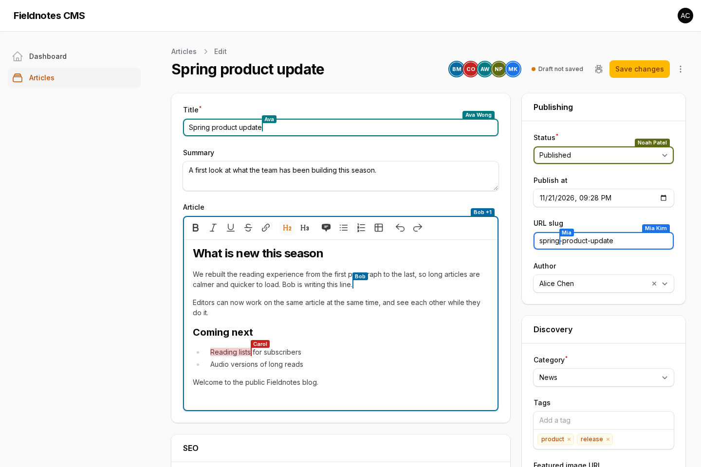

Nothing in your form changes. The package reads the form you already have and decides, field by field, how to share it.

## 2. Which fields are live

| Field | How it is shared |
| --- | --- |
| `TextInput` (text, search, tel, url), `Textarea` | character by character |
| `RichEditor` without custom blocks, mentions or plugins | characters, blocks and formatting |
| `Select`, `Toggle`, `Checkbox`, `CheckboxList`, `Radio`, `ToggleButtons`, `TagsInput`, `DateTimePicker`, `ColorPicker`, `Slider`, masked, email and number inputs | the latest choice wins |
| `Repeater` and `Builder` with simple fields inside | adding, removing and moving items merge; text inputs and textareas inside items merge by character; other sub-fields take the latest choice |
| Many-to-many `Select` and `CheckboxList` | merge on save, unless you mark them `collaborative()` |
| `FileUpload` | each file is stored as soon as it is uploaded; adding, removing and reordering files merge |
| Passwords, media library uploads, hidden and disabled fields, lists holding uploads, rich text or nested lists | merge on save |

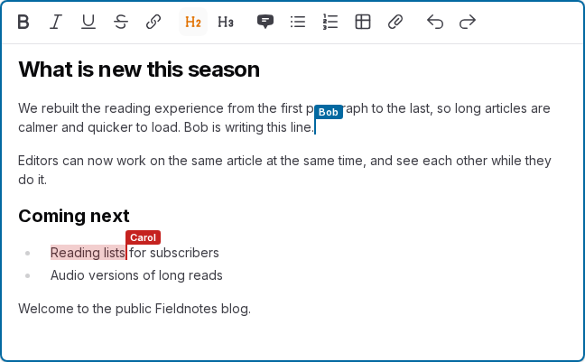

**Turn a field off**, for example one that only some people should change:

```php
TextInput::make('internal_notes')->collaborative(false);
```

**Let only some people edit a field live**, with a Gate ability. The field is shared with everybody; those the Gate refuses still edit it, and their change merges on save:

```php
TextInput::make('seo_title')->collaborative('edit-seo');
```

Prefer this to a closure such as `fn () => Gate::allows(...)`: a closure decides whether the field is in the draft at all, which must be the same for everybody.

**Turn a relationship field on.** Many-to-many fields are saved through the relationship, so they are off by default. Mark them to share the chosen ids:

```php
Select::make('tags')->relationship('tags', 'name')->multiple()->collaborative();
```

**Turn live editing off** for the whole panel or for some records. People still see each other, and saving still merges:

```php
CollaborationPlugin::make()
    ->liveEditing(fn (?Model $record): bool => ! $record?->is_locked);
```

### Fields from other packages, and fields that cannot be live

A field the package does not know, such as a third-party editor, merges on save. People still see who is in it, and while somebody is, everybody else reads "Bob is editing this field. Changes merge when saved." under it.

- **Lock it while somebody is in it**, so two people never change it at once: `->lockWhileEditing()` on the field, or `CollaborationPlugin::make()->lockWhileEditing()` for every field that cannot be live (`->lockWhileEditing(false)` exempts one). The field is read-only for the others until that person leaves it or goes idle.
- **Share its whole value live** with `->collaborative()`: the latest change wins, through Livewire state, so most editors update for everybody without any code. For merging by character and carets, write an [adapter](#adapters-for-other-editors).

**Translated pages** (a locale switcher, such as `lara-zeus/spatie-translatable`'s) are live too, with one shared draft per language. Everybody on the record is in one room and sees each other, while English typing stays in the English draft and Chinese in the Chinese one. Switching language moves your page to that language's draft, including colleagues' unsaved typing there. Saving publishes the language you are on; the others keep what is stored, and their drafts are saved from their own language.

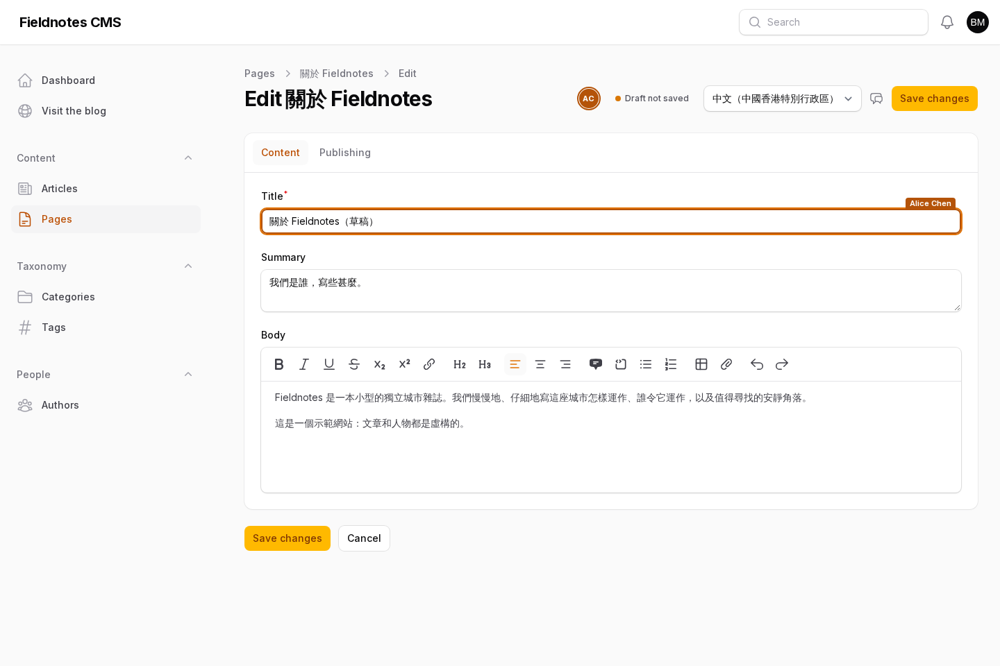

Date pickers with a personal timezone always merge on save, because their state differs per person.

## 3. Saving, drafts and conflicts

All live fields of a record share **one draft**, kept in the database. It survives everybody leaving and coming back.

- **Save** validates and publishes the draft as it is at that moment, including what colleagues typed. Fields that are not live are merged with what is stored.
- The header shows **Unsaved changes** while the draft differs from the record. Anyone who can edit can **discard** the draft from the people panel.
- A change made outside the form, such as a modal, an import or a queued job, is merged into what people are typing.
- A save from a browser that is not live (offline too long, or with live editing off) wins in the fields it changed.

When a field that is not live was changed by two people, Save shows a **conflict dialog**: for each field, keep yours or take theirs.

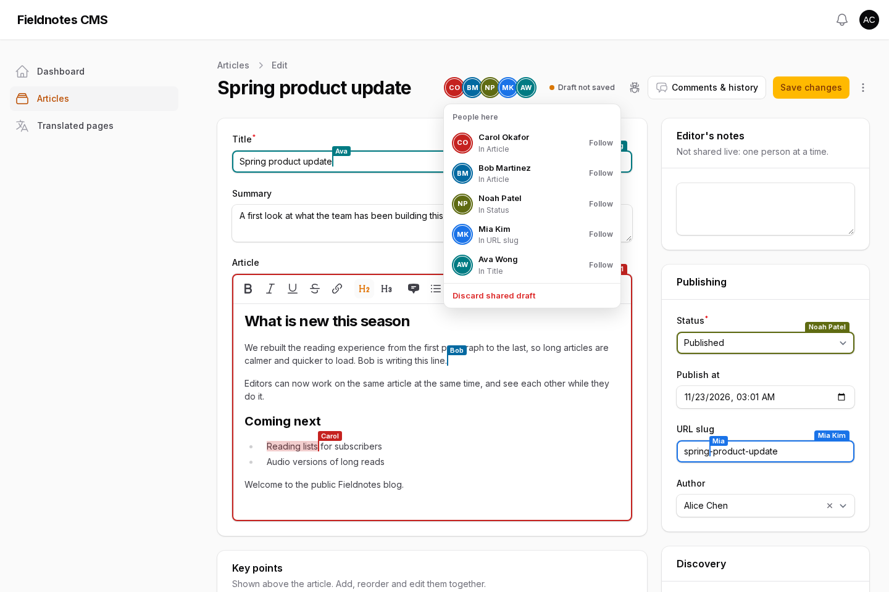

### When a record is deleted

Everybody still on it is told at once, by name: "Bob deleted this record". Their form stays on screen, read-only, with **Copy my text**, so nothing typed is lost.

- With **soft deletes**, the shared draft is kept, and people the policy allows to `restore` get a **Restore** button that brings the record back with the draft.
- When a record is **gone for good** (no soft deletes, or force-deleted), its draft, edit history and unsaved images are deleted with it.
- Someone who could no longer reach the record anyway, say after moving to another team, is only told they no longer have access.

This works for deletions anywhere in your app that go through Eloquent, not only Filament's delete action. Query-builder deletes (`Post::where(...)->delete()`) fire no model events: call `app(DeletedRecords::class)->deleted($post)` for those, if people may be editing them.

**React to saves and merges** with Laravel events, all in `SolutionForest\FilamentCollaboration\Events`:

| Event | When | Has |
| --- | --- | --- |
| `SharedDraftSaved` | a save published the shared draft | `record`, `user`, `fields`, `contributors` |
| `ChangesMerged` | a save took someone else's changes in fields this user did not touch | `record`, `user`, `fields`, `theirName` |
| `ConflictDetected` | a save stopped to ask which value to keep | `record`, `user`, `fields`, `theirName` |
| `ConflictResolved` | the user chose in the conflict dialog | `record`, `user`, `choices` |
| `DraftEdited` | with `audit()` on, someone changed a field, once per minute | `record`, `by`, `field`, `minute` |

### Auditing who changed what

A save publishes what colleagues typed too, so an audit that only records who pressed Save credits them with everybody's work. `SharedDraftSaved` says who changed each field since it was last saved:

```php
use SolutionForest\FilamentCollaboration\Events\SharedDraftSaved;

Event::listen(function (SharedDraftSaved $event): void {
    $event->user;               // who pressed Save
    $event->contributorNames(); // ['title' => ['Alice Chen', 'Bob Martinez'], 'excerpt' => ['Bob Martinez']]
    $event->contributors();     // each person once, as Contributor: type, id, name, at, user()
});
```

With [`spatie/laravel-activitylog`](https://github.com/spatie/laravel-activitylog):

```php
Event::listen(function (SharedDraftSaved $event): void {
    activity()
        ->performedOn($event->record)
        ->causedBy($event->user)
        ->withProperties(['contributors' => $event->contributorNames()])
        ->log('saved the shared draft');
});
```

With [`owen-it/laravel-auditing`](https://github.com/owen-it/laravel-auditing), add the names to the audit the save creates, in the model's `transformAudit()`, or record a custom audit from the same listener.

### An edit trail, saved or not

Turn on `audit()` to also keep a trail of every change to the draft, including drafts that are discarded and never saved. It is one row per person, field and minute, not one per keystroke, in `filament_collaboration_edits`:

```php
CollaborationPlugin::make()->audit();
```

```php
use SolutionForest\FilamentCollaboration\Documents\EditTrail;

app(EditTrail::class)->for($post);
// [['user_name' => 'Alice Chen', 'user_type' => User::class, 'user_id' => '7', 'field' => 'title', 'at' => CarbonImmutable], ...]
```

Each new row also dispatches `DraftEdited` (`record`, `by`, `field`, `minute`), to send wherever you like. The trail is kept until you delete it, for example with a scheduled `DB::table('filament_collaboration_edits')->where('minute', '<', now()->subYear()->getTimestamp())->delete()`.

### Comments and version history

Add `CollaborationPanelAction` to the page's header actions. It opens one slide-over with two tabs, **Comments** and **History**. Its **History** tab lists the shared draft's versions, newest first, with who changed it and which fields:

```php
use SolutionForest\FilamentCollaboration\Actions\CollaborationPanelAction;

protected function getHeaderActions(): array
{
    return [
        CollaborationPanelAction::make(),
    ];
}
```

A version is kept at most every five minutes while people edit, on every save, and before and after a restore, up to the last 100 per draft, in `filament_collaboration_versions`. **Restore** puts the draft back as it was, for everybody in the room at once; the draft from before the restore stays in the list, so a restore can be undone. It changes only the live fields the person may edit, and nothing is saved until somebody saves. On a translated page each language has its own history.

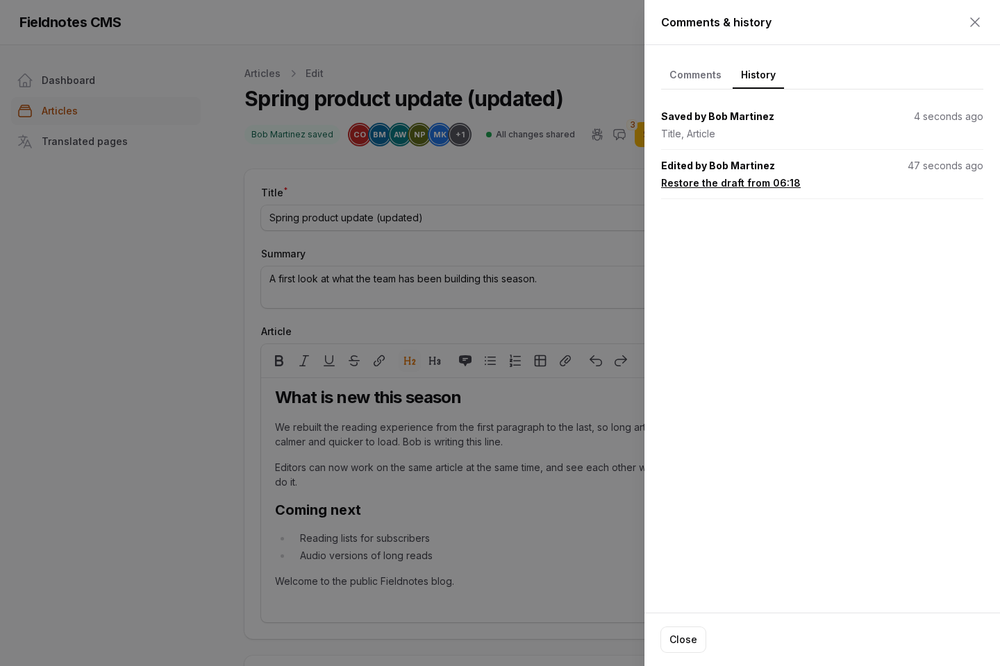

**Comments** are on the record, or on one of its fields. Everybody who can open the record reads them and can comment. The author and anybody who may edit the record can resolve or reopen a comment. The button shows how many comments are open. Every language of a translated record shares its comments, and deleting a record for good deletes them too.

To let people `@mention` each other, say who may be mentioned on a record. The comment box suggests their names after `@`. Each person mentioned gets a Filament [database notification](https://filamentphp.com/docs/notifications/database-notifications) that links back to the record:

```php
CollaborationPlugin::make()
    ->mentionable(fn (Model $record) => User::query()->where('team_id', $record->team_id));

$panel->databaseNotifications(); // to show them in the panel
```

Pass `notify: false` to skip the notifications. `CommentPosted` (`record`, `by`, `comment`, `url`) is dispatched for every comment, and `$event->comment->mentions` lists the people it mentions, so you can send the news anywhere else too.

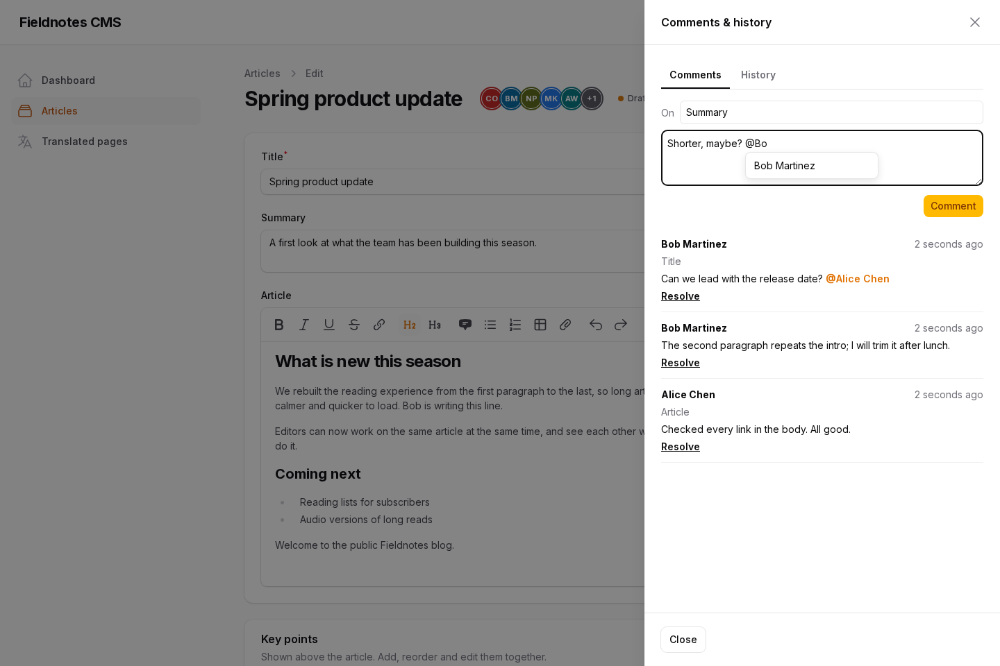

## 4. Presence in tables and modals

**Fields out of sight.** When somebody is in a field behind a tab that is not selected, a wizard step that is not current, or a collapsed section, their initials show on that tab, step or section header. Choosing them in the avatar list opens the tab and the section and scrolls to the field. There is nothing to set up.

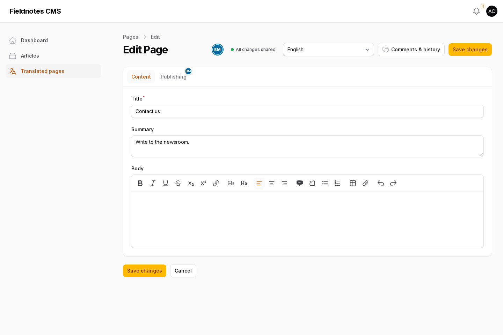

**Following a colleague.** In the avatar list, **Follow** next to somebody keeps going to whichever field they are in, opening tabs and sections on the way, so you can watch a walkthrough without chasing it. Clicking or typing anywhere in the form stops it, and so does **Stop following** or them leaving.

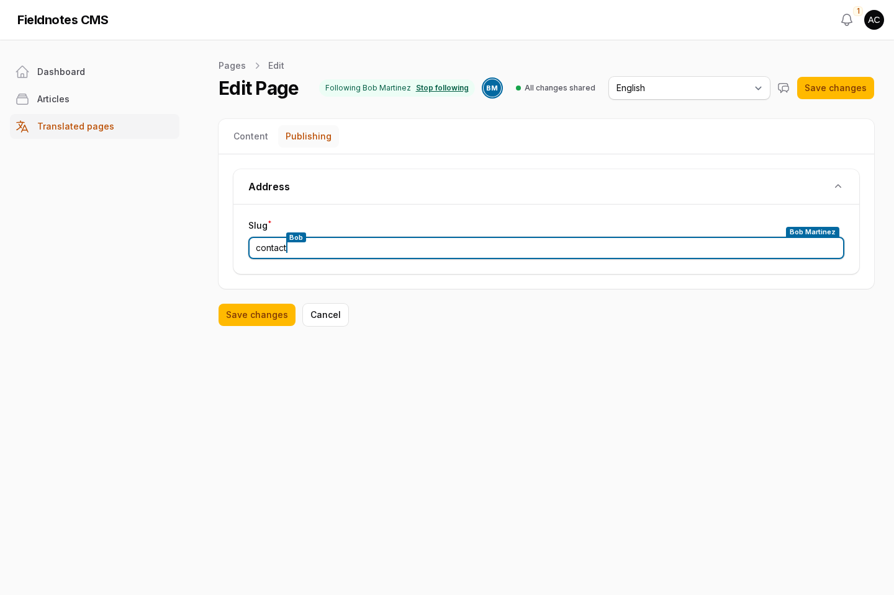

**Relation managers.** Add `SharesRelationChanges` to a relation manager, and what one person creates, edits, deletes, attaches or toggles in it shows at once in everybody else's copy of the page, over Reverb or at their next poll:

```php
use SolutionForest\FilamentCollaboration\Concerns\SharesRelationChanges;

class TasksRelationManager extends RelationManager
{
    use SharesRelationChanges;
}
```

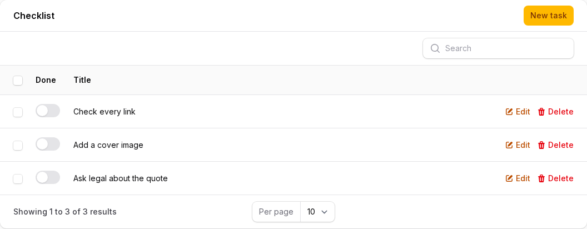

**A column with the people on each record:**

```php
use SolutionForest\FilamentCollaboration\Tables\PresenceColumn;

public static function table(Table $table): Table
{
    return $table
        ->poll('3s')
        ->columns([
            // ...
            PresenceColumn::make(),
        ]);
}
```

The list page needs the `HasPresence` trait.

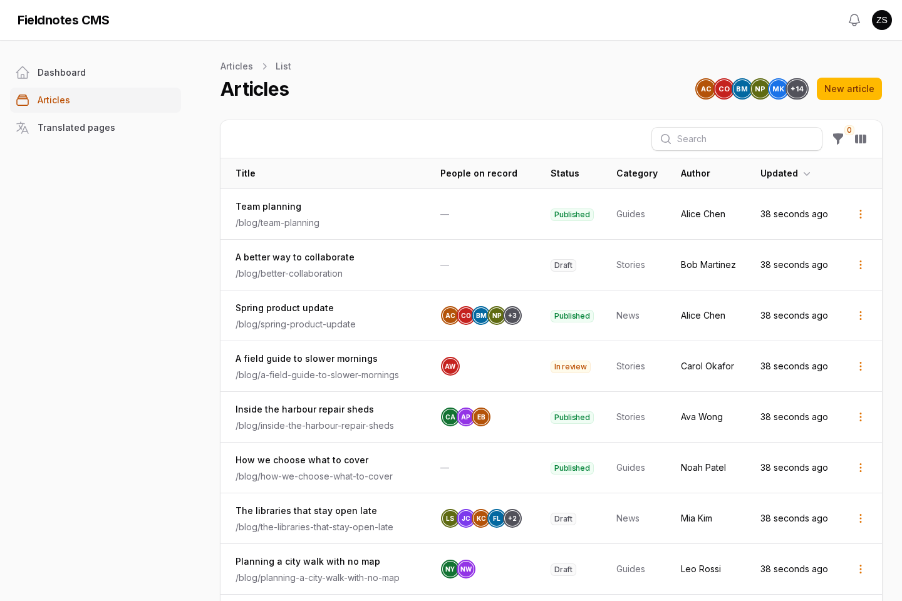

**An edit modal with presence and merge on save:**

```php
->recordActions([
    EditAction::make()->collaborate(),
])
```

Call `collaborate()` last: it wraps the action's lifecycle hooks. Fields in modals merge on save; they are not live.

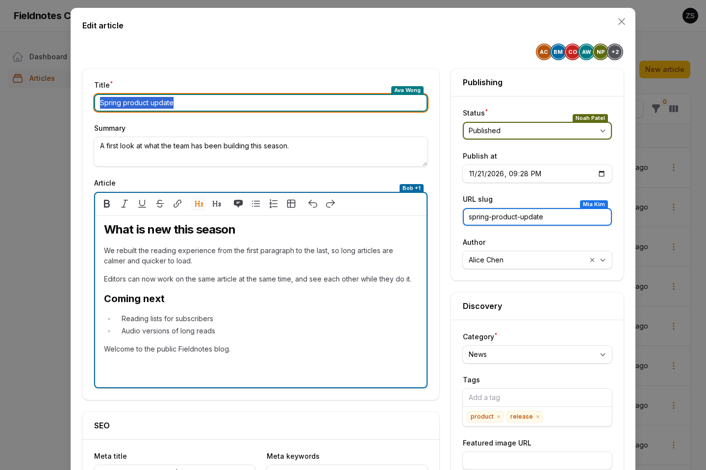

## 5. Real time with Reverb

Out of the box, browsers poll every 0.4 seconds while working together, and less often when alone, idle or in a crowd. That needs nothing but your Laravel app.

With broadcasting, the server pushes each change as it happens. A keystroke reaches others in about 60 ms instead of 350 ms, and browsers poll only every 8 seconds as a safety net.

**1. Install Reverb** and start it:

```bash
php artisan install:broadcasting --reverb
php artisan reverb:start
```

**2. Give Filament an Echo connection.** Publish its config with `php artisan vendor:publish --tag=filament-config`, then in `config/filament.php`:

```php
'broadcasting' => [
    'echo' => [
        'broadcaster' => 'reverb',
        'key' => env('REVERB_APP_KEY'),
        'wsHost' => env('REVERB_HOST'),
        'wsPort' => env('REVERB_PORT'),
        'wssPort' => env('REVERB_PORT'),
        'forceTLS' => env('REVERB_SCHEME', 'https') === 'https',
        'enabledTransports' => ['ws', 'wss'],
        'authEndpoint' => '/broadcasting/auth',
    ],
],
```

**3. Turn it on:**

```php
CollaborationPlugin::make()->broadcasting();
// or only where Reverb is configured:
CollaborationPlugin::make()->broadcasting(fn (): bool => config('broadcasting.default') === 'reverb');
```

Any Pusher-compatible broadcaster works the same way.

Edits are still sent over HTTP, where each one is authorised and validated; only the answers come over the socket. Each tab listens on a private channel for its room and the fields it may read, and the channel only admits people who have a tab there. If Reverb goes down, nothing breaks: browsers fall back to polling.

## 6. Configuration

### On the plugin

```php
CollaborationPlugin::make()
    ->liveEditing(fn (?Model $record): bool => true)
    ->broadcasting()
    ->pollingInterval(400)
    ->avatarLimit(5)
    ->colors(['#1a73e8', '#d93025', '#188038'])
    ->scopeRoomsUsing(fn (): mixed => auth()->user()?->team_id)
    ->presenceRenderHook(PanelsRenderHook::PAGE_HEADER_ACTIONS_BEFORE)
    ->fieldTypes([new StarRatingType])
    ->debug(fn (): bool => app()->isLocal())
    ->reportEditorErrors(fn (): bool => app()->isLocal());
```

| Method | Default | What it does |
| --- | --- | --- |
| `liveEditing()` | on | `false`, or a closure given the `$record`: presence and merge on save only |
| `broadcasting()` | off | push changes over Laravel broadcasting; see [Reverb](#5-real-time-with-reverb) |
| `pollingInterval()` | 400 | milliseconds between syncs while working together (at least 200) |
| `avatarLimit()` | 5 | avatars in the header before "+3" |
| `colors()` | 16 colours | each person's colour; white text must be readable on each |
| `scopeRoomsUsing()` | none | separate rooms per team, for tenancy without Filament tenancy |
| `presenceRenderHook()` | header actions | where the avatars render; use one of Filament's page hooks |
| `fieldTypes()` | none | your own field types, tried before the built-in ones; see [Extending](#9-extending) |
| `debug()` | off | shows `CollaborationDebugAction`; see [Debugging](#10-debugging) |
| `mentionable($users, notify:)` | none | who can be `@mentioned` in comments; see [Comments](#comments-and-version-history) |
| `reportEditorErrors()` | off | logs rich editor errors with their content; see [Debugging](#10-debugging) |
| `lockWhileEditing()` | off | fields that cannot be live are read-only for others while somebody is in them |
| `audit()` | off | keeps a per-minute trail of who changed which field; see [Auditing](#an-edit-trail-saved-or-not) |

### In `config/filament-collaboration.php`

Publish it with `php artisan vendor:publish --tag=filament-collaboration-config`, or set the environment variables.

| Key | Environment variable | Default | What it does |
| --- | --- | --- | --- |
| `connection` | `FILAMENT_COLLABORATION_CONNECTION` | default connection | where drafts and presence are stored |
| `cache_store` | `FILAMENT_COLLABORATION_CACHE_STORE` | default store | serialises saves; needs atomic locks, shared by all servers |
| `presence` | `FILAMENT_COLLABORATION_PRESENCE` | `database` | where presence is kept: `database`, or `redis` |
| `redis_connection` | `FILAMENT_COLLABORATION_REDIS_CONNECTION` | `default` | the Redis connection for `redis` presence |
| `presence_timeout` | `FILAMENT_COLLABORATION_PRESENCE_TIMEOUT` | 20 | seconds without a heartbeat before someone disappears |
| `compact_after` | `FILAMENT_COLLABORATION_COMPACT_AFTER` | 1800 | seconds before a clean draft's edit history is discarded |
| `token_lifetime` | `FILAMENT_COLLABORATION_TOKEN_LIFETIME` | 900 | seconds a room token is valid; open pages renew it |
| `prune_uploads_after` | `FILAMENT_COLLABORATION_PRUNE_UPLOADS_AFTER` | 24 | hours before unsaved images are deleted; `null` turns it off |
| `rate_limit` | `FILAMENT_COLLABORATION_RATE_LIMIT` | 2400 | sync requests per user per minute, across their tabs |

### Many servers, and presence in Redis

Several application servers can share one database: shared drafts are kept in it, so it does not matter which server a request reaches. Give them a shared `cache_store` with atomic locks, such as Redis or the database, so saves are serialised across servers.

Presence is a heartbeat from every open tab every few seconds. In the database, that is a small write per heartbeat. For many people, keep it in Redis instead, with no database writes for presence. It uses Laravel's Redis connection, either phpredis or predis:

```dotenv
FILAMENT_COLLABORATION_PRESENCE=redis
FILAMENT_COLLABORATION_REDIS_CONNECTION=default
```

Nothing else changes. Tabs left behind expire by themselves, and a room nobody is in takes up no space. To keep presence somewhere else, bind your own `PresenceRepository`. `demo/tests/Feature/PresenceRepositoryTest.php` lists the behaviour it needs.

To measure your own setup, run the demo's load test with two servers: `SERVERS=2 PRESENCE=redis npm run test:load -- 300 45`. Add `TRANSPORT=reverb` to push over Reverb. It checks that everybody sees everybody across both servers, that every editor ends with the same text, and that no typing is lost. The **Load** workflow runs it on a CI runner.

### PHPStan

So PHPStan knows about `collaborative()` and `collaborate()`, include the extension. With `phpstan/extension-installer` this happens by itself; otherwise:

```neon
includes:
    - vendor/solutionforest/filament-collaboration/extension.neon
```

## 7. Permissions and security

**What is checked.** Each page renders an encrypted token that expires. Every sync request checks the user, panel, tenant, room scope and record again, and asks the resource's `canEdit()` or `canView()`, so your policies apply. A record that is gone, or out of reach, answers 404, the same as one that never existed.

**What is validated.** A browser may only change fields its user can edit, only with its own operation ids, and only with allow-listed rich content: attributes like `onclick`, `javascript:` links or custom block HTML never reach another browser. A picked field only accepts the options its user was offered. Field names and carets are only sent to people who can see that field.

**Know this before enabling it.** A shared draft is shared: when you save, you publish what colleagues put in the fields you can edit, validated by your form. Free-text fields have no allow-list, so if only some people may change a field at all, give the others `->disabled()` or `->collaborative(false)`.

**Who may edit live.** Whoever may edit a record may collaborate on it, unless your policy says otherwise with a `collaborate` ability. Those it refuses still edit the record, see who is there, and merge on save; they just do not type into the shared draft:

```php
class PostPolicy
{
    public function collaborate(User $user, Post $post): bool
    {
        return ! $user->is_reviewer;
    }
}
```

`Gate::define('collaborate', ...)` works too. It is checked on every sync, so withdrawing it takes effect on the next request: the page renders again without live fields. `Permissions::mayCollaborate($post)` asks the same question in your own code.

**After changing roles or field access**, tell open tabs to fetch a new token:

```php
use SolutionForest\FilamentCollaboration\Permissions;

Permissions::changed($post); // people on this record
Permissions::changed();      // everybody
```

or from the command line: `php artisan filament-collaboration:refresh-permissions`. Open tabs re-render on their next sync, at once with Reverb. Without it, tokens renew within 15 minutes. Revoking access to the record itself takes effect on the next request.

## 8. Images and uploads

An image inserted into a rich editor is stored at once, so whoever saves keeps it, even if they are not the one who uploaded it.

- When a save puts it in the record, it belongs to the record, like any other Filament upload.
- Discarding the draft deletes the images nobody saved.
- Images removed before saving are deleted by `php artisan filament-collaboration:prune-uploads`, scheduled daily for images older than `prune_uploads_after` hours. Undo can bring an image back until then. **Your scheduler must be running** (`php artisan schedule:work`, or cron).

**Upload fields** work the same way. A file is checked against the field's own rules (type, size, count) and stored the moment it finishes uploading, so everybody sees it at once and anybody's save keeps it. The list of files is shared like a repeater's items: adding, removing and reordering merge. A browser can only add files stored for this draft, or files the record already has.

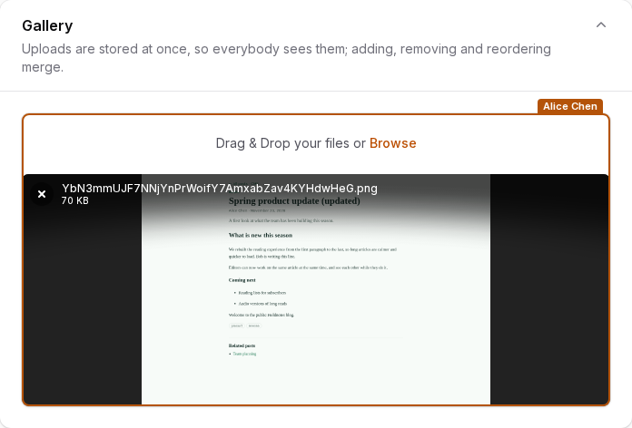

If you use Filament's `preventFilePathTampering()`, also allow files stored for the draft, as a colleague's file is not yet one of the record's:

```php
FileUpload::make('gallery')->preventFilePathTampering(allowFilePathUsing: fn (string $file): bool => app(SharedUploads::class)->isStored($file));
```

Media library and Curator fields, which save through a relationship, still merge on save.

## 9. Extending

**Your own field type.** Tell the package how to share a field it does not know:

```php
use Filament\Forms\Components\Field;
use SolutionForest\FilamentCollaboration\Contracts\FieldType;
use SolutionForest\FilamentCollaboration\Enums\FieldKind;

class StarRatingType implements FieldType
{
    public function supports(Field $field): bool
    {
        return $field instanceof StarRating;
    }

    public function getKind(Field $field): ?FieldKind
    {
        return FieldKind::Value; // Text, RichText, Value, Items, or null to merge on save
    }
}
```

```php
CollaborationPlugin::make()->fieldTypes([new StarRatingType]);
```

For a picker, `ValueType::make([StarRating::class])` does the same without a class of your own.

### Adapters for other editors

> **New to adapters?** [Make your own component live](custom-components.md) builds two from scratch, a text composer with carets and a star rating, with tests.

A third-party editor, such as a TinyMCE or CKEditor field, keeps its content in its own JavaScript object. An **adapter** is a short script that tells this package how to read and write that editor and where its caret is. The package does the rest: merging, carets, presence, saving, permissions.

**Filament's own fields use the same API.** Text inputs and textareas (`filament-text-input`), pickers (`filament-value`), the rich editor (`filament-rich-editor`), and the Markdown and code editors are all adapters registered with `registerAdapter()`, in `resources/js/adapters/filament.js`. An adapter you write gets exactly what they get, and they are the best examples to copy. Only repeaters, builders and uploads, which are Filament's own structure rather than one editor, are bound differently.

**1. Say which fields use it**, in PHP. A package does this once, in its service provider's `boot()`:

```php
use SolutionForest\FilamentCollaboration\CollaborationPlugin;
use SolutionForest\FilamentCollaboration\Enums\FieldKind;
use SolutionForest\FilamentCollaboration\Fields\Types\AdapterType;

CollaborationPlugin::registerFieldTypes(
    AdapterType::make([TinyEditor::class], adapter: 'tinymce', kind: FieldKind::RichText),
);
```

An app can also name the adapter on one field: `TinyEditor::make('body')->collaborative(adapter: 'tinymce', as: FieldKind::RichText)`.

| Kind | Adapter `format` | Merges |
| --- | --- | --- |
| `FieldKind::Text` | `text`: a string | by character |
| `FieldKind::RichText` | `html`: an HTML string | by character, block and mark; see [HTML editors](#html-editors) |
| `FieldKind::RichText` | `rich`: a ProseMirror / TipTap JSON document | the same, for editors built on ProseMirror; `filamentCollaboration.prosemirror` has the helpers Filament's rich editor uses |
| `FieldKind::Value` | `value`: any JSON | the latest change wins |

**2. Register the adapter**, in JavaScript loaded on the panel:

```js
function register({ registerAdapter }) {
    registerAdapter('my-editor', {
        format: 'text',
        attach({ element, changed, moved }) {
            const editor = MyEditor.instanceIn(element) // however your editor is found

            if (!editor) return null // not ready yet: asked again shortly

            editor.on('change', changed)
            editor.on('selectionchange', moved)

            return {
                read: () => editor.getText(),
                write: (text) => editor.setText(text), // better: change only what differs; see minimalChange()
                selection: () => editor.getSelection(), // { anchor, head }, UTF-16 offsets into read()
                setSelection: ({ anchor, head }) => editor.select(anchor, head),
                caretRect: (offset) => editor.coordsAt(offset), // a DOMRect, for other people's carets
                isFocused: () => editor.hasFocus(),
                destroy: () => editor.off('change', changed),
            }
        },
    })
}

window.filamentCollaboration
    ? register(window.filamentCollaboration)
    : window.addEventListener('filament-collaboration:init', (event) => register(event.detail), { once: true })
```

`attach()` may also return `false` to say the editor cannot be live in this browser; the field then merges on save. The CodeMirror 6 adapter does this in Safari, where a change arriving mid-keystroke can lose that keystroke.

Only `read` and `write` are required; without the selection methods, edits still merge but carets are not kept or shown. The other capabilities Filament's own adapters use are open to yours:

| | |
| --- | --- |
| `undo()` / `redo()` (on the context) | call them on Ctrl+Z instead of the editor's own undo: only this person's typing is undone, never a colleague's (`text` format) |
| `recover(error, details)` (on the context) | the editor threw on a change: the draft is shown again, the error reported; repeated failures make the field merge on save |
| `geometry({ anchor, head })` (on the handle) | a caret and a whole selection to draw, instead of `caretRect()` |
| `isDirty()` (on the handle) | false when nothing changed since the last `read()`, for editors where reading is costly | Write only what differs, so the editor keeps its own undo history: `minimalChange(old, next)` in `resources/js/adapters/registry.js` gives the range to replace.

If the adapter is missing, or throws, the field simply merges on save as before.

The demo's `packages/` folder has working adapters for TinyMCE, CKEditor 5, Quill and Trix:

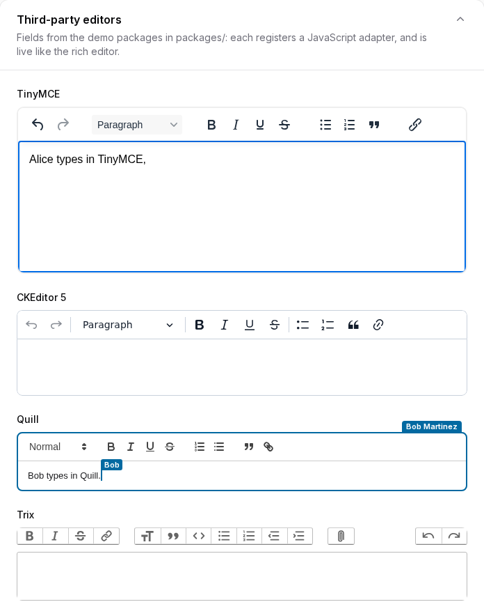

### HTML editors

TinyMCE, CKEditor, Quill, Trix and most WYSIWYG editors hold HTML. Merging HTML by character could break its tags, so an adapter with `format: 'html'` hands over HTML, and the package turns it into the same document the built-in rich editor shares: paragraphs, headings, bold, italic, underline, strike, code, links, lists, quotes, tables, images and line breaks. Those merge by character, block and mark, with carets; anything else in the HTML is kept as its text. On save, the field gets HTML back.

Carets are positions in that document. `filamentCollaboration.html` maps them to and from the editor's DOM, so an HTML adapter is mostly glue:

```js
registerAdapter('tinymce', {
    format: 'html',
    attach({ element, changed, moved }) {
        const editor = element.querySelector('.my-tinymce')?.editor // however you keep it

        if (!editor?.initialized) return null

        const html = window.filamentCollaboration.html
        const body = () => editor.getBody()

        editor.on('input change undo redo', changed)
        editor.on('SelectionChange', moved)

        return {
            read: () => editor.getContent(),
            write: (value) => editor.setContent(value),
            selection: () => html.selectionIn(body(), editor.getDoc().getSelection()),
            setSelection: (positions) => editor.selection.setRng(html.select(body(), positions)),
            caretRect: (position) => html.caretRectAt(body(), position),
            isFocused: () => editor.hasFocus(),
        }
    },
})
```

Register its PHP side with `FieldKind::RichText`. Keep the editor object off Alpine's reactive data (for example on the element): editors such as CKEditor and Quill break behind its proxy.

**Working examples** are in `demo/packages/`: a TinyMCE, a CKEditor 5, a Quill and a Trix field, each a small Filament package with its adapter in `resources/js/editor.js` and its registration in the service provider. The demo's article form uses all four, and the browser tests type in each from two browsers at once. Rebuild them with `npm run build:editors` in `demo/`. TinyMCE and CKEditor 5 are GPL-licensed when used without a commercial licence key.

**Your own presence storage.** Presence is stored in the database by default. Bind your own implementation of `Contracts\PresenceRepository`, for example on Redis, in a service provider.

### With an AI assistant

The package ships a [Laravel Boost](https://laravel.com/docs/boost) skill, `filament-collaboration-development`, and a short guideline in `resources/boost`. Boost installs a package's skills once the app opts in, in `boost.json`:

```json
{
    "packages": ["solutionforest/filament-collaboration"]
}
```

```bash
php artisan boost:update
```

The guideline goes into your `CLAUDE.md` / `AGENTS.md`, and the skill into `.claude/skills` and `.agents/skills`. It covers the traits, which fields are live, permissions, comments and history, relation managers, adapters, Reverb and Redis presence, testing and common mistakes. The demo uses it.

## 10. Debugging

**The collaboration inspector** is a slide-over showing what this tab syncs: round trip, sequence, unsent changes and each field's state. It never shows field contents.

```php
use SolutionForest\FilamentCollaboration\Actions\CollaborationDebugAction;

protected function getHeaderActions(): array
{
    return [
        CollaborationDebugAction::make(),
        // ...
    ];
}
```

It stays hidden unless the panel enables it:

```php
CollaborationPlugin::make()->debug(fn (): bool => app()->isLocal());
```

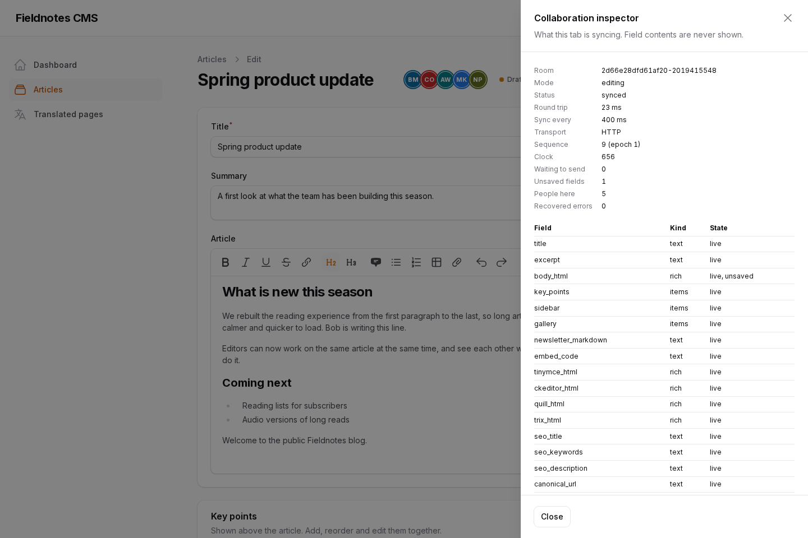

**When the rich editor fails.** Should ProseMirror refuse a change, the editor shows the shared draft again with the caret where it was. Nothing typed is lost. After four failures in ten seconds it gives up and the field merges on save. Each recovery is counted in the inspector and sent as a browser event:

```js
window.addEventListener('filament-collaboration:recovered', ({ detail }) => {
    // detail: { field, error, key, selection, doc, at, room }
    Sentry.captureMessage(`Editor recovered: ${detail.error}`, { extra: detail })
})
```

To log a warning on the server with the document and selection it failed on, ready to replay, turn on `reportEditorErrors()`. The log then holds field contents, so enable it only where that is acceptable. It is limited to fields the user can write, and 20 reports per user an hour.

## 11. Troubleshooting

**Nobody appears, or fields stay "merge on save".** Check that the page uses the trait, that both users can `update` the record, and that the field is in the [live list](#2-which-fields-are-live). The inspector shows each field's state.

**No avatars at all, or a 404 for `collaboration.js`.** The package's assets are published by Filament: run `php artisan filament:assets` after installing or updating.

**Saves hang or wait.** Saves are serialised with a cache lock. Use a cache store with atomic locks that every server shares (Redis or database), set as `cache_store`.

**Reverb is configured, but changes are still polled.** The inspector's *Transport* line says whether the WebSocket is connected. Check `config/filament.php` has `broadcasting.echo`, the plugin has `->broadcasting()`, and `/broadcasting/auth` answers 200.

**`php artisan serve` is slow with several people.** It serves one request at a time unless told otherwise. Use `php artisan serve --no-reload` (several workers), Octane, or a real web server.

**Links lose their CSS class, or a pasted image makes the editor merge on save.** Links pasted with a class lose the class, and images pasted as base64 cannot be shared live. Upload images instead.

**Something else.** Turn on the [inspector](#10-debugging) and open an issue with what it shows.
