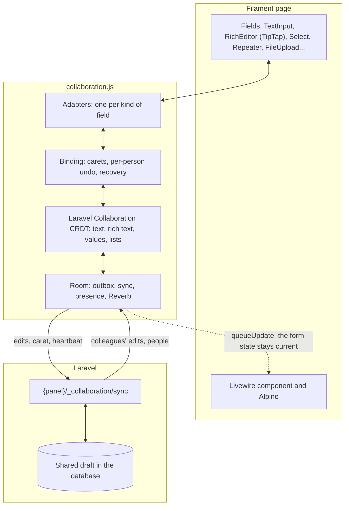
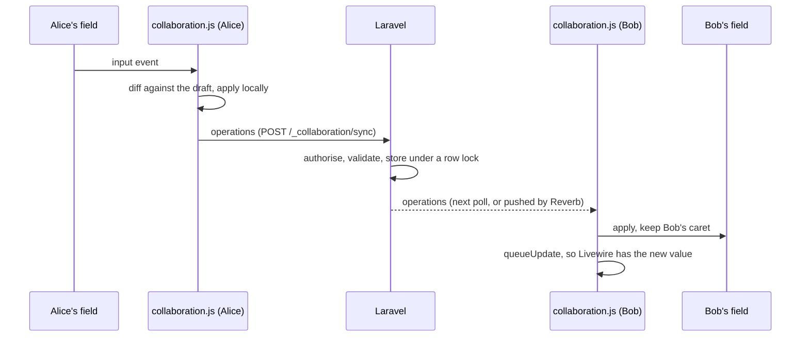
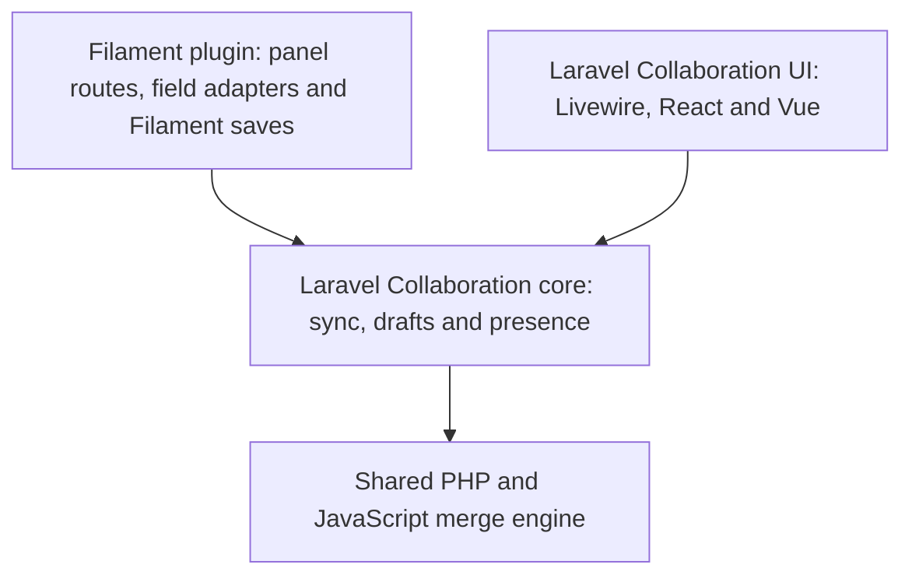

# How it works with Filament

Filament Collaboration connects panel fields and Filament's save lifecycle to the merge engine, drafts and sync provided by Laravel Collaboration.

## The browser script and Filament

The package does not replace Filament's fields. Its script, `collaboration.js`, runs beside them and listens.

1. **The page says it is collaborative.** The `InteractsWithCollaboration` trait renders a small hidden element through a Filament render hook. It carries an encrypted token, the sync URL and the list of live fields. The script, registered as a normal Filament asset, finds the element and attaches to the page's Livewire component.
2. **Each field gets an adapter.** An adapter knows how to read and write one kind of field. A text input is read from the browser's `input` event. Filament's `RichEditor` is TipTap (ProseMirror) inside an Alpine component, so its adapter takes the editor from Alpine with `getEditor()`. Selects, toggles, dates, repeaters, uploads, and the Markdown and code editors have adapters too, through the same `FilamentCollaboration.adapter()` that [other editors](guide.md#adapters-for-other-editors) use.
3. **Your typing becomes small operations.** The adapter compares the field with the shared draft, and only what changed becomes operations, such as "insert *ing* after this character". They are applied to your copy at once.
4. **Typing goes to the panel's sync endpoint.** Every 0.4 seconds, or at once with Reverb, the browser sends its operations to `{panel}/_collaboration/sync`. The core rechecks access through the Filament integration, validates each operation, updates the shared draft and returns the changes this browser is missing.
5. **Colleagues' changes go into the field, and into Livewire.** The adapter writes them into the field with your caret kept in place, and the script tells Livewire the new value with `queueUpdate`, so the form state is right without a Livewire request per keystroke.
6. **Save is still Filament's Save.** The trait's `save()` takes a lock, takes the shared draft with everybody's typing, merges the fields that cannot be live, then calls Filament's own save. Validation, hooks and notifications run as usual.

## Why not Yjs

Both Yjs and the Laravel Collaboration engine are **CRDTs** that converge when people edit concurrently. The engine was originally developed for Filament Collaboration and now lives in the Laravel Collaboration core.

| | Yjs | Filament Collaboration on the Laravel core |
| --- | --- | --- |
| What it is | A mature, widely used JavaScript library | A small engine in PHP and JavaScript |
| Who orders the edits | Nobody: copies merge in any order, even peer to peer | Laravel: each edit is applied under a database row lock |
| Can Laravel read the document? | Not easily: Yjs has its own binary format, with no mature PHP version, so it usually needs a Node server such as y-websocket or Hocuspocus | Yes: PHP reads and changes the draft itself, so it checks every operation before anybody else sees it |
| Server to run | A separate Node WebSocket server | Your Laravel app, over HTTP polling or Laravel Reverb |
| Permissions per field | Hard: the whole document goes to every client | Built in: fields a person cannot see never reach their browser |
| Saving to the model | Your own code turns the document back into form data | Built in: Save publishes the draft through Filament's save |
| Editor bindings | Many ready-made ones | Adapters for Filament's fields, and examples for TinyMCE, CKEditor, Quill and Trix |
| Data format | Compact binary, highly optimised | JSON, easy to read and debug; old history is compacted once a draft is saved and nobody is editing |
| Maturity | Years of production use | New, tested with sessions replayed in PHP and JavaScript, 2,000 random four-person sessions that must converge, and chaos and load tests |

Yjs suits apps where browsers sync directly, or through a Node server that never needs to understand the content. A Filament form needs the server to understand it: to check permissions per field, validate HTML and save through Filament. An engine that also runs in PHP keeps Laravel in charge, with no Node server to run. The price is that it is younger than Yjs and does less: only what forms need, which is text, rich text, picked values and lists. [Architecture](architecture.md#the-shared-draft) explains how it works.

## Without Filament

Laravel Collaboration supports standalone Livewire and Inertia (React or Vue) forms, with its own setup, UI and routes. [Laravel Collaboration installation](https://github.com/solutionforest/laravel-collaboration#installation)

The Filament plugin uses its own room client and field adapters, which integrate with Livewire and Alpine in the panel. The core's JavaScript merge engine runs in browsers and Node, and its PHP counterpart runs without Filament.
